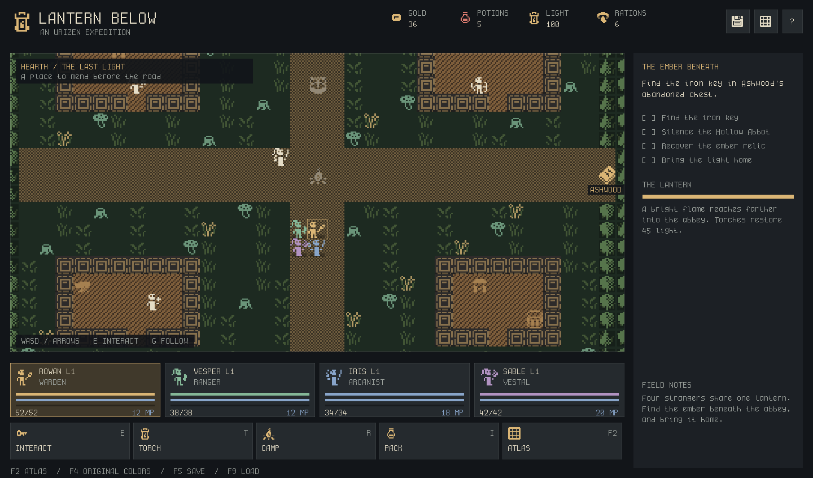
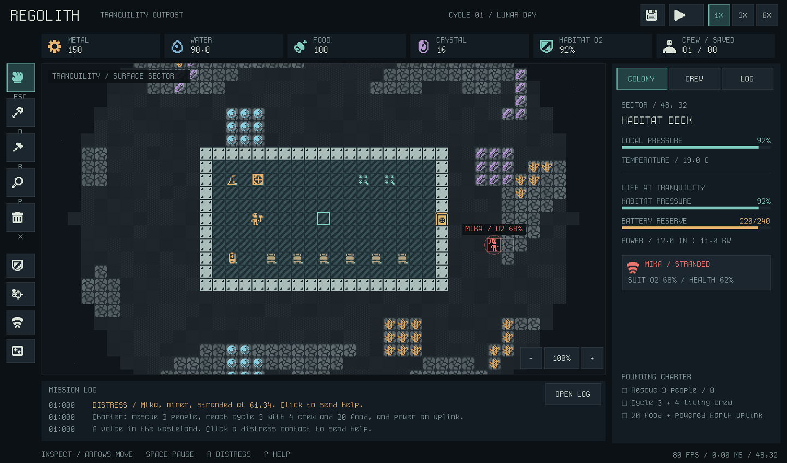

# Ithica

**A small life on the Moon.** Build a salvage colony from the people you rescue, then take those same residents into the wasteland. Keep the setting mysterious and the survival decisions readable.

**Start here:** [Project state and agent reference](docs/PROJECT_STATE.md) records what is implemented. The [Ithica integration plan](docs/ITHICA_PLAN.md) consolidates the approved direction, clock rules, shared population, lunar content and naming migration. [AGENTS.md](AGENTS.md) tells future agents how to maintain both.

The target is one **MonoGame + C#** game: continuous colony time, with both the colony and expedition waiting at RPG decisions. Committed expedition actions advance the shared timeline. **Integration is planned, not yet implemented.** The repository currently contains two independently playable prototypes with separate saves and legacy code names; their existing launchers remain accurate below.

| Prototype | Launch | Explore |
| --- | --- | --- |
| Colony (legacy name: Regolith) | `./play.sh` | Lunar colony, cellular atmosphere, work orders, and survivor rescues |
| Expedition (legacy name: Lantern Below) | `./rpg.sh` | Top-down party RPG, cellular forests/ponds, WFC dungeons, spreading hazards, turn-based skills, and a return-home quest |
| Sprite atlas | `./rpg.sh --scene atlas` or open [assets/atlas.html](assets/atlas.html) | All 7,115 occupied sprites, current bindings, uncertainty, future ideas, and an offline scene-painting lab |



The RPG runs from the same .NET 10 setup as the colony game. Start with `./rpg.sh`; use `./rpg.sh --demo` for a combat scene. [The RPG guide](docs/LANTERN.md) includes controls, the expedition route, headless checks, and current scope. Try `./rpg.sh --seed 1337 --scene forest` or `./rpg.sh --seed 7 --scene crypt` to explore generated areas. [Procedural generation](docs/PROCEDURAL_GENERATION.md) documents the quest graph, WFC, cellular terrain and hazards. Both games have separate saves. F2 opens the complete sprite viewer inside the RPG; F4 compares original colors with its game palette.

[catalog.json](assets/catalog.json) is now schema 3: the original inventory plus **11,887 region records**, with identity evidence, per-game runtime usage, RPG affordances, generation rules, visual review notes, adaptation limits, and future ideas. Existing sprite IDs, crops, source PNGs, colony bindings, and the frozen import audit are preserved. [Catalog structure and regeneration](assets/reference/CATALOG_V2.md) · [RPG binding table](assets/reference/rpg-bindings.md) · [104-crop Urizen generation review](assets/reference/urizen-generation.md).

## Colony prototype

A sprite-based colony simulator built with **C# / .NET 10 and MonoGame DesktopGL**. Ada starts alone at the prototype's Tranquility outpost. Click stranded people in the wasteland, send a rescue, escort them into shelter, and build a colony from the people you save. The integration plan replaces separate prototype progression with the shared Ithica loop; the following instructions describe the current implementation.



## Play

Install the [.NET 10 SDK](https://dotnet.microsoft.com/download/dotnet/10.0), then run:

```sh
./play.sh
./play.sh --load
./play.sh --seed 8675309
./play.sh --demo --skip-intro
```

The launcher works from any directory. On macOS/Linux, `./tools/setup-dotnet.sh` can install SDK 10.0.402 into `~/.local/share/regolith/dotnet` without changing your PATH. The SDK is already installed there on the development machine. First launch restores the pinned NuGet packages and builds Release.

On Windows, or with the SDK on your PATH:

```sh
dotnet run --project src/Ithica.Client --configuration Release
```

The native window defaults to **1440×900** and supports resizing down to **1024×720**. Use `--window-size 1280x800` to set its initial size. MonoGame DesktopGL targets Windows, macOS, and Linux; native rendering has been exercised on macOS Intel. Other desktop platforms still need a graphical smoke run. Linux needs a working desktop/OpenGL environment; headless tools need only .NET.

The six-section tutorial opens before time starts. Enter advances; Left goes back; Esc closes it. Reopen it with **T**. Tutorial and construction menus hold simulation time.

## First colony

1. **Save Mika.** Click the red distress contact on the map, then press Space to run time. A rescue costs **2 food + 2 water**. Ada travels out, shares oxygen, and escorts Mika home at half speed. Recruitment happens only inside pressure. **R** locates contacts; it does not open a separate expedition screen.
2. **Supply the outpost.** Press **D**, then click cyan ice for water, amber ore for metal, or purple crystal for equipment. Jobs reserve workers automatically. **P** surveys nearby open terrain.
3. **Expand carefully.** **B** opens construction. Machines need deck and connected power. Enclose new deck with hull and an airlock, and add generation/storage before new consumers. **O** cycles oxygen, heat, and power overlays. Repair meteor breaches with pressure hull.
4. **Bring more people home.** Incoming distress signals have real oxygen and health countdowns. New arrivals need food, sleep, and recovery before becoming reliable workers.
5. **Earn the founding charter.** Rescue three people, reach cycle 3 with four living crew and 20 food, and power a pressurized Earth uplink. The uplink costs 60 metal, 20 crystal, and 5 kW. Keep building afterward.

## Controls

| Input | Action |
| --- | --- |
| Left click / Enter | Inspect, rescue a stranded person, or place the active order |
| Mouse wheel over map | Zoom around the pointer, from 25% to 300% |
| Right / middle mouse drag | Pan the map |
| Arrows / H J K L | Move the map cursor; Shift moves five cells, except Shift+L loads |
| + / − or Page Up / Down | Zoom around the cursor |
| 0 / map zoom percentage | Reset zoom |
| Space / 1 2 3 / period | Pause; select 1× / 3× / 8×; pause and advance one tick |
| D / B / P / X | Mine or salvage / construction / survey / cancel with refund |
| V | Start/cancel a rectangular designation; click or Enter confirms |
| Esc | Close menu, cancel selection, or return to inspection |
| R / G / F | Locate distress contact / return home / follow selected crew |
| C / E | Crew manifest / expanded log; mouse wheel scrolls the panel |
| O | Cycle terrain, oxygen, temperature, and power views |
| T / ? | Six-section tutorial / control reference |
| S or F5 / Shift+L or F9 | Save / load (loading pauses) |
| F11 / Q | Toggle fullscreen / save and quit |

Closing the window also saves a living colony. After colony loss, quitting preserves the previous save; **N** starts again. The default C# save is `~/.regolith/colony-csharp.json`; `--save PATH` selects another slot. Writes are atomic and include random state and in-flight expeditions. Python saves are a separate format and are retained at `~/.regolith/colony.json`.

## Simulation and structure

Geology uses five passes of a Moore-neighborhood cellular automaton. Atmosphere, heat, and fire use local four-neighbor, double-buffered updates. Hull blocks gas; exterior vacuum drains breached rooms; airlocks pass people and electrical connectivity while sealing the air. Connected decks form separate power islands with local battery banks and prioritized life support. Crew track health, food, rest, morale, and suit oxygen while finding routes to work and rescues.

The implementation separates the game from its presentation:

| Project | Responsibility |
| --- | --- |
| [Regolith.Core](src/Ithica.Core/Colony/) | Graphics-free simulation, contiguous world arrays, jobs, routing, rescue, atomic saves |
| [Regolith.Client](src/Ithica.Client/) | Colony map rendering, mouse/keyboard input, HUD/tutorial |
| [Regolith.Graphics](src/Ithica.Graphics/) | Shared sprite loader, palette masks, bitmap text, and camera; lazy texture loading for the atlas |
| [Lantern.Core](src/Ithica.Core/Expeditions/) / [Lantern.Client](src/Ithica.Client/Preview/) | Independent RPG rules and its MonoGame presentation |
| [Regolith.Tools](src/Ithica.Tools/) | Deterministic headless runs and simulation benchmarks |
| [Regolith.Core.Tests](tests/Ithica.Core.Tests/Colony/) | Environment, work, power, rescue, progression, and saved-continuation checks |
| [legacy/python](legacy/python/) | Archived terminal prototype, runnable independently |

This is a playable single-layer foundation. Resources go directly into shared inventory; crew may share a cell. Hauling, multi-level excavation, combat, modding, rich social behavior, and background simulation threads are future work. See [architecture](docs/ARCHITECTURE.md) for design decisions and [performance](docs/PERFORMANCE.md) for measured limits and reproduction commands.

## Assets

All original spritesheets, stable sprite IDs, crop rectangles, and proposed mappings are preserved. The client uses **Urizen tiles and bitmap font**, **Godot node icons**, and **keyboard/mouse prompts** from the three imported packs. Palette tinting and black-background removal happen in texture copies during loading.

[assets/ithica-colony-sprites.json](assets/ithica-colony-sprites.json) selects **154 existing IDs** for 60 semantic bindings and 94 glyphs. Regenerate this small runtime selection with `python3 tools/build_runtime_assets.py` (standard library only). Python is not a game dependency, and no content-pipeline editor is required.

The full [sprite guide](assets/SPRITE_GUIDE.md), [visual browser](assets/sprites.html), and [sprite catalog](assets/sprites.json) retain every occupied region and future-use proposal. Their unused/proposed flags describe the original import audit; use the runtime manifest for current bindings. [catalog.json](assets/catalog.json) retains the original image hashes and archive inventory. Publishers and CC0 declarations are recorded in [CREDITS.txt](assets/CREDITS.txt).

## Build and verify

Use `./tools/dotnet.sh` in place of `dotnet` if you used the per-user SDK installer.

```sh
dotnet restore Ithica.sln --locked-mode
dotnet build Ithica.sln --configuration Release --no-restore
dotnet test Ithica.sln --configuration Release --no-build
./play.sh --headless 700 --demo --seed 42
./play.sh --smoke-test --screenshot /tmp/regolith-smoke.png
./play.sh --benchmark --width 256 --height 256 --agents 1000 --ticks 120
```

Headless runs print JSON and never write saves. The graphical smoke run opens a real window, exercises tutorial navigation, direct rescue clicks, zoom, recruitment, build cancellation, and save/load, then exits without changing the player's save. `--screenshot PATH --frames 12` captures a normal view and exits; omit `--frames` for an interactive session.

NuGet versions are pinned with lockfiles. The included CI workflow builds and runs core/headless checks on Linux, Windows, and macOS; it does not certify native graphics on those platforms. To create a local distributable for the current machine:

```sh
dotnet publish src/Ithica.Client --configuration Release --self-contained false --output artifacts/game
```

The output includes runtime artwork and credits. This framework-dependent build requires .NET 10 on the destination machine; native installers, signing, and store publishing are not configured.
