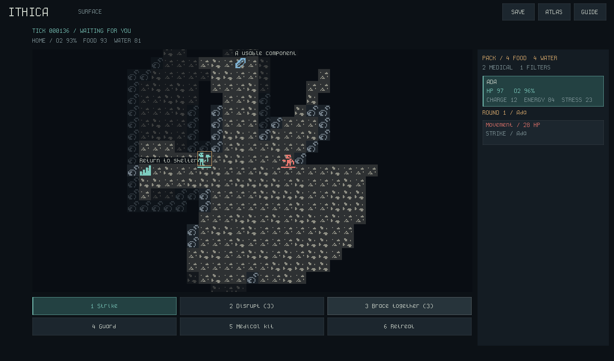

# Ithica

**A small life on the Moon.** Build a salvage colony from the people you rescue, then take those same residents into the wasteland. Recover something useful, bring it home, and leave some questions unanswered.

A playable **C# / .NET 10 + MonoGame DesktopGL** game. The colony runs continuously while unpaused. Outside, exploration and combat wait for your decisions; accepted actions advance both the expedition and home together. One population, stockpile, progression and save connect the phases.

**Start here:** [Project state and agent reference](docs/PROJECT_STATE.md) is the master source of truth. [AGENTS.md](AGENTS.md) defines repository guidance. [Verification](docs/VERIFICATION.md) records actual checks and implementation checkpoints.



## Play

Install the [.NET 10 SDK](https://dotnet.microsoft.com/download/dotnet/10.0), then run:

```sh
./ithica.sh
./ithica.sh --load
./ithica.sh --seed 1337
```

`./tools/setup-dotnet.sh` optionally installs the pinned SDK without changing your PATH. The launcher also finds the existing historical per-user SDK. On Windows or with a system SDK:

```sh
dotnet run --project src/Ithica.Client --configuration Release
```

The normal window is 1440×900, resizable down to 1024×720. Use `--window-size 1280x800`. Rendering has been checked on macOS Intel and Fedora 44 under WSLg; native Windows and standalone Linux desktop sessions still need graphical smoke checks.

## First colony and outing

1. Read the six-section tutorial. Space runs/pauses home time; mouse wheel zooms at the pointer and right/middle drag pans.
2. Click the distress contact directly on the map. Select Ada and pack supplies. Preparation shows the stock and workers left at home; Enter departs.
3. Move with WASD/arrows or clicks. E interacts, Space waits. Every accepted action spends logical time; thinking spends none. Share supplies with the stranded person, then escort them to the return approach.
4. Dismiss the paused arrival report. The survivor becomes a resident in breathable shelter and needs food, sleep and recovery. The same people can later work at home or leave together.
5. Visit the newly available salvage site. Read enemy intentions, use 1–6 and click targets, recover a component and bring it home. U selects **suit service**, built on connected deck for 24 metal, 4 crystal and 1 component.
6. Powered suit service equips more efficient suits and reveals a deeper signal. Repair useful equipment there while keeping the shelter alive. A failed return leaves carried salvage recoverable at its site.

D designates mining/salvage; B opens ordinary construction; P surveys; X cancels and refunds; V starts a rectangle. C shows residents, O cycles home overlays, and R locates distress. Outside, O refills suits, H treats a selected resident, C rests and T suppresses nearby exposure. These actions use supplies and time. [Full controls and current rules](docs/PROJECT_STATE.md#controls).

F5 saves and F9 loads the **whole campaign** in either phase. F2 opens the complete sprite atlas in the same window. The normal save is `~/.ithica/campaign.json`; `--save PATH` selects a slot. Q/window close autosaves a living normal campaign; explicit preview scenes and test tools preserve player saves. Import an inactive legacy colony with `--import-colony PATH`; its original file remains untouched.

## Inspect and verify

```sh
./ithica.sh --scene surface
./ithica.sh --scene battle
./ithica.sh --scene structure
./ithica.sh --scene atlas
./ithica.sh --headless
./ithica.sh --validate-seeds 1000 --seed -500
./ithica.sh --smoke-test --screenshot /tmp/ithica-smoke.png
```

Scenes use real commands to reach a fresh state and do not autosave on exit. `--headless` completes rescue, recovery, salvage combat, returned cargo and a constructed upgrade without opening a window or writing a player save.

```sh
./tools/dotnet.sh restore Ithica.sln --locked-mode
./tools/dotnet.sh build Ithica.sln --configuration Release --no-restore
./tools/dotnet.sh test Ithica.sln --configuration Release --no-build
python3 tools/build_game_catalog.py --check
./tools/dotnet.sh publish src/Ithica.Client --configuration Release --self-contained false --output artifacts/ithica
```

Core rules, generation and saves have no graphics dependency. [Architecture](docs/ARCHITECTURE.md) describes ownership; [performance](docs/PERFORMANCE.md) records workloads and limits. The current game has finite persistent sites, aggregate inventory and overlapping people; hauling, z-levels, rich social behavior and tactical movement remain future work.

## Art and tools

All three imported packs, original sheets, stable IDs and crop evidence are preserved. [catalog.json](assets/catalog.json), schema 5, covers **11,887 regions / 7,115 occupied crops**. Generic artwork descriptions, type, subject evidence and measured foreground colors are independent of current/preview/unused game status; all 7,115 occupied crops have recorded visual inspection, with uncertainty retained. Generic atlas controls are being completed. Search with `python3 tools/query_assets.py --type actor --color green`. Ithica selects 166 IDs including shared font/UI, with 14 explicit field aliases. [Current casting](assets/reference/ithica-sprites.md) · [Catalog authoring and generic queries](assets/reference/CATALOG_V2.md) · [104-crop Urizen review](assets/reference/urizen-generation.md) · [Credits](assets/CREDITS.txt).

Open [assets/atlas.html](assets/atlas.html) for the offline browser and layered scene lab, or F2 in-game. Scene experiments export exact-ID JSON and PNG; runtime recipe import is not implemented. Texture masks are in-memory copies; source PNGs are never repainted or repacked. Python is only needed to regenerate development assets.

`play.sh` is a compatibility alias for Ithica. `rpg.sh` / `--preview` retain the independent fantasy prototype for regression and its old saves; see [the legacy guide](docs/LEGACY_RPG.md). The original Python terminal implementation remains archived under [legacy/python](legacy/python/README.md).
