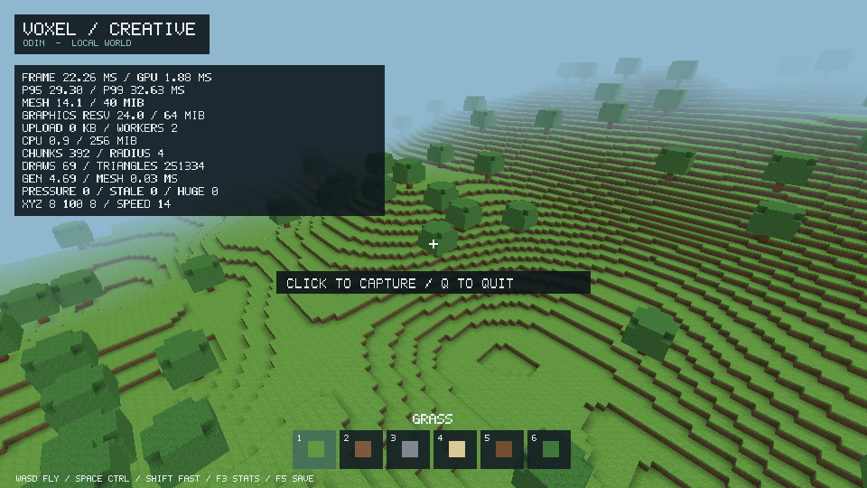

# Voxel / Creative

A native creative-mode voxel sandbox in **Odin**, built around small graphics-memory budgets. Fly through seeded terrain, dig into caves, and build with a six-block hotbar. Terrain streams on background workers; the renderer uses exposed-face greedy meshing, packed vertices, and a tiny original pixel-texture array.



**Local creative mode is implemented. P2P collaborative building is the next tranche**, recorded below. Survival, crafting, mobs, fluids, dynamic shadows, and multiplayer are outside this version.

## Build and play

Requires Python 3.12+, the pinned Odin compiler, and an OpenGL 3.3-capable desktop driver. No Python packages are required. All paths below are relative to this repository.

```sh
python3 scripts/bootstrap.py
python3 scripts/build.py run
```

On Windows, use `python` instead of `python3`. Install Visual Studio's C++ build tools/Windows SDK if Odin cannot locate the native linker. The Windows Odin release supplies GLFW; no engine installation is needed.

On Linux, install GLFW's development package and a C linker, for example `clang libglfw3-dev` on Debian/Ubuntu. This WSL environment has no package manager or clang, so the following optional command installs a checksum-verified GLFW binary **locally** and the build script uses `cc` to link Odin's object code:

```sh
python3 scripts/bootstrap.py --local-glfw  # Linux x86_64 only
python3 scripts/build.py run
```

The local GLFW option still requires the system X11 runtime libraries. It does not change system packages. To run the built Linux binary directly with this local library, set `LD_LIBRARY_PATH="$PWD/.tools/lib"`.

On Apple Silicon, install Xcode Command Line Tools, then use the same bootstrap/build commands. macOS uses its OpenGL core driver and Odin's bundled GLFW. For Intel Macs, this Odin release has no prebuilt compiler: build [Odin](https://github.com/odin-lang/Odin) at the commit in `toolchain.json` using upstream instructions, then set `ODIN_BIN` to that compiler. The application code does not require an Apple Silicon-specific feature.

`toolchain.json` pins compiler binaries, source commit, and download checksums. Downloads stay in ignored `.tools/`; builds, saves, and benchmark data are ignored too. The build script rejects a different compiler revision. Textures, shaders, and the bitmap UI font are embedded in the executable.

## Controls

| Input | Action |
|---|---|
| Mouse | Look |
| WASD | Fly horizontally |
| Space / Left Ctrl | Fly up / down |
| Left Shift | Fly four times faster |
| `+` / `-` | Increase / decrease base speed |
| Left / right mouse button | Break / place a block |
| 1–6 | Grass, dirt, stone, sand, wood, leaves |
| Escape / click | Release / recapture the mouse |
| F3 | Toggle performance statistics |
| F5 | Save immediately |
| Q / close window | Save and quit |

Flight has no collision or gravity. Blocks can be edited within eight blocks of the camera. The bottom bedrock layer is protected; the world spans Y=0–255. All leaves are opaque.

Worlds default to `saves/creative.vox`. Existing saves take precedence over `--seed`. A corrupt or incompatible save stops startup and is preserved. `--no-save` starts a disposable world without reading or writing the save file.

## Memory profiles

| Profile | Graphics budget | Initial mesh allowance | CPU budget | Maximum radius | Window size |
|---|---:|---:|---:|---:|---|
| `tiny` (default) | 64 MiB | 40 MiB | 256 MiB | 4 chunks | 960×540 |
| `low` | 128 MiB | 88 MiB | 512 MiB | 8 chunks | 1280×720 |
| `standard` | 256 MiB | 184 MiB | 1 GiB | 12 chunks | 1920×1080 |

Tiny is the starting point for GPUs with **128–256 MB available memory**. The larger profiles and overrides support more capable machines. A chunk is 32 blocks wide; radius is a residency ceiling, not a guaranteed visible distance. Memory pressure reduces it. Fog blends terrain into the streaming boundary.

```sh
python3 scripts/build.py run -- --profile low --seed 123
python3 scripts/build.py run -- --gpu-mb 32 --cpu-mb 128 --radius 3 --width 800 --height 450
python3 scripts/build.py run -- --profile standard --workers 4 --upload-kb 512
```

Graphics accounting includes allocated mesh capacity (including cached and replacement buffers), a fixed renderer allowance, and a conservative framebuffer reservation. It **does not measure the driver's physical VRAM working set**. Integrated GPUs share system memory. CPU statistics cover tracked application heap allocations; allocator bookkeeping, temporary arenas, thread stacks, and driver allocations are additional overhead. See [architecture](docs/architecture.md) for admission rules and limits.

`--help` lists all options. `--frames N`, `--seconds N`, `--hidden`, and `--screenshot PATH.ppm` support unattended graphical runs; they still require a working display and OpenGL context.

## Verify and benchmark

```sh
python3 scripts/build.py check
python3 scripts/build.py test
python3 scripts/smoke.py
python3 scripts/benchmark.py --scene normal --seconds 15
python3 scripts/benchmark.py --scene normal --seconds 15 --naive
python3 scripts/benchmark.py --scene flight --seconds 52
python3 scripts/benchmark.py --scene edit --seconds 10
python3 scripts/benchmark.py --scene dense --seconds 10 --upload-kb 64
```

Core tests run without a display. Graphical smoke checks need a display; on Linux the script starts its own Xvfb server when available and uses XTest for actual input. Install `xvfb libxtst6` or pass `--skip-input` when XTest is unavailable. The smoke suite validates rendering, real movement and block edits, F5 saving, save reload/corruption handling, resizing, invalid arguments, automatic draw-distance reduction, and upload/memory budgets.

Benchmark CSVs and JSON reports go to `benchmarks/`. The runner records hardware/driver output, command-line settings, frame percentiles, memory, draw counts, and upload sizes, and fails if sampled budgets are exceeded. The 52-second flight repeats a route twice and checks for growing memory residency. `--naive-mesh` disables greedy merging as a comparison baseline. [Measured results and limitations](docs/performance.md) are recorded separately.

Native CI builds and core tests are configured for Linux, Windows, and Apple Silicon macOS. Linux CI additionally runs graphical checks on software OpenGL. Native Windows/macOS graphical testing and physical low-memory GPU measurements remain outstanding.

## Next tranche: P2P creative multiplayer

P2P is a required continuation, not an optional stretch feature. The next tranche will add direct peer connectivity and collaborative block editing, including world/version handshake, initial snapshots, ordered edits, peer movement, and persistence ownership. NAT traversal/relay policy and authority details must be settled with the networking work.

The current engine already keeps rendering separate from world queries, chunk snapshots, and sequenced edit commands. It contains **no networking transport or multiplayer UI yet**. Before relying on seed-only world regeneration across peers, run the terrain fixtures on every supported platform and establish a generator version and synchronization checks.
