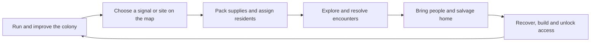

# Ithica: integration plan

**Design consolidated: 2026-10-20. Status: approved direction; implementation pending.**

**Ithica** is a mysterious lunar salvage colony game. Start with one person, keep a shelter alive, and venture into the surrounding wasteland to recover supplies, investigate what remains, and bring stranded people home. Those people become the colony and the expedition party: their skills, injuries, work and survival connect both halves of play.

This plan defines the intended combined game. [PROJECT_STATE.md](PROJECT_STATE.md) remains the source of truth for what runs today. The repository currently has two separate MonoGame/C# prototypes under the legacy names **Regolith** and **Lantern Below**. A combined campaign, Ithica executable and new save format do not exist yet. Existing commands and filenames remain valid until their migration stage lands.

## Contents

- [Decisions and scope](#decisions-and-scope)
- [The play loop](#the-play-loop)
- [One population](#one-population)
- [Time and player decisions](#time-and-player-decisions)
- [Survival, progression and failure](#survival-progression-and-failure)
- [The Moon and the unknown](#the-moon-and-the-unknown)
- [Procedural generation and persistent sites](#procedural-generation-and-persistent-sites)
- [Implementation feasibility](#implementation-feasibility)
- [Target architecture](#target-architecture)
- [Ithica naming and compatibility migration](#ithica-naming-and-compatibility-migration)
- [Implementation order and acceptance](#implementation-order-and-acceptance)
- [Verification and completion](#verification-and-completion)
- [Design references](#design-references)

## Decisions and scope

These are the agreed product constraints:

| Decision | Contract |
| --- | --- |
| Name | **Ithica**, with this spelling, across the game and current project branding |
| Setting | The Moon; a salvage colony amid unexplained remnants and distress signals |
| Presentation | Sprite-based, top-down, mouse and keyboard; retain the existing sheets, stable sprite IDs, crops and mapping evidence |
| Technology | C# / .NET and MonoGame; graphics-free gameplay rules and headless verification |
| Opening | One colonist; growth comes through finding and rescuing people |
| Colony time | Continuous fixed-step simulation while unpaused |
| Expedition time | Waits for player decisions in exploration and combat; committed actions advance the shared timeline |
| Integration | One population, economy, progression and save; workers and expedition members are the same people |
| Tone | Sparse names and explanations; mystery through discovery rather than a named fantasy cosmology |

Exact action costs, supply rates, party limits, encounter balance and failure penalties below are **initial implementation proposals**, not additional user-approved numerical requirements. Put them in explicit tuning data. Do not treat the existing prototype's fantasy names, fixed four-person party or three-area quest as the final lunar content roster.

The first delivery is one complete rescue → recovery → salvage → colony upgrade → further expedition loop. Large armies, z-levels, a full hauling economy, diplomacy, an endless world and a rich social simulator are outside that delivery. Preserve room to extend the simulation without building all of those systems first.

## The play loop



1. **Maintain a shelter.** Manage pressure, power, food, water, rest, medicine and useful work as continuous colony time passes.
2. **Respond to something visible.** Click a stranded person, distress contact or discovered site directly on the map. Show what is known, the approach and the practical cost. Retain the current direct-click rescue interaction; a separate expedition tab is not required to begin a rescue.
3. **Choose who leaves.** Pack supplies and select residents. Their absence removes their labor from the colony. Show the known home supply margin and staffing consequences before departure.
4. **Take control outside.** Move a small party through top-down exploration and turn-based encounters. Thinking is free; acting advances expedition conditions and the settlement together.
5. **Return with a consequence.** A rescued specialist, recovered part, usable resource site, repaired installation or new access should change the colony's next decision. Returning people keep their injuries, fatigue and experience.
6. **Make the next trip different.** A medical facility improves recovery; more dependable life support permits longer absences; equipment and recovered components open routes or interactions. The colony improves expedition options as well as replenishing consumables.

This should produce competing needs rather than unrelated chores. Sending the best engineer helps with damaged machinery outside but leaves fewer hands at home. Rescuing someone adds a person and a capability, while requiring shelter and care before they become reliable labor.

### First complete sequence

Start with Ada alone, a functioning minimal shelter, a short safe supply margin and a nearby distress contact. The first outing is playable with one person and introduces movement, action costs, oxygen and a rescue without requiring a full combat party. Return with the survivor, accommodate and treat them, and resume colony time to establish basic production.

The next reachable site contains salvage needed for one meaningful shelter improvement. Recover it, install the improvement and expose a further reachable objective. Completing this sequence is the first integration milestone; it does not require inventing named regions, factions or an extensive storyline.

## One population

Use one authoritative resident record with a stable `ResidentId`. Colony jobs, expedition membership and battle units reference that identity. A profession describes productive work; a field role describes available expedition abilities. Neither requires a second copy of the person.

| Shared state | Required behavior |
| --- | --- |
| Health, injuries and stress | Damage or treatment in either phase affects the same resident |
| Hunger, fatigue and suit oxygen | Consume through one needs schedule; never tick the same person in both subsystem loops |
| Skills and equipment | Determine both relevant work and field capabilities; retain a small readable initial ability set |
| Location | At colony, at an expedition site, or stranded; stored separately from assignment and care status |
| Assignment | Work, expedition, idle or recovery; a resident away from home cannot reserve or complete colony jobs |
| Survival | A living resident outside the colony still counts as living population; an empty home is not automatically defeat |

Initial party proposal: **one to four residents**. Early routes support a solo rescuer; larger groups are earned through rescue. Do not create four free heroes on entering expedition mode. The old four classes can inform field abilities without bringing four pre-existing fantasy companions into every new campaign.

Keep one shared inventory authority, with an explicit transfer into carried expedition supplies. Loading, spending, returning cargo and canceling departure must each happen once. Supplies carried away are unavailable to home production. Basic stock can remain aggregate quantities in the first delivery; this integration does not require physical hauling or individual item entities.

The current battle model copies hero health into units and synchronizes it afterward. Replace permanent duplicate ownership with resident references or a controlled encounter projection whose writes commit to the resident exactly once. UI party positions and initiative slots are not resident IDs. A two-person party must work even when those residents have IDs 7 and 19.

### Departure and return

- Opening preparation pauses the colony. Inspecting loadout or canceling does not advance time. Show known supply and staffing risks, including the valid case of Ada leaving an empty but mechanically operating shelter.
- Confirming departure validates and reserves supplies, releases the party's home work, commits their location and changes clock mode as one transaction. A failed validation leaves the campaign untouched.
- Approach travel has a stated logical cost, applied once. Loading the site or watching a transition consumes no additional time.
- Return travel also has a stated cost. On arrival, deposit cargo once, retain each resident's condition, and release them to recovery or available work as appropriate.
- Pause on the arrival report; resume the previously selected colony speed and pause state after dismissal. Never charge a second generic "expedition duration" after already charging the actions and travel.

## Time and player decisions

### One campaign clock

Use an integer `CampaignTick` and a single `CampaignClock` owned by the shared campaign. The difference between phases is **what requests ticks**, not whether the colony exists while the party is away.

| Situation | Time source | Colony | Expedition |
| --- | --- | --- | --- |
| Colony running | Elapsed-time accumulator requests fixed ticks | Advances | No player-controlled expedition in progress |
| Colony paused, tutorial or preparation open | None | Waits | Waits |
| Expedition awaiting a decision | None | Waits | Waits |
| Accepted expedition action | Configured logical action cost | Advances by that cost | Resolves action and time-dependent effects |
| Automatic enemy resolution | Deterministic queued action cost | Advances by that cost | Resolves until the next player decision |
| Animation, inspection, targeting or reading | None | Waits | Only presentation changes |

Both exploration and combat follow the expedition rule. The colony does **not** run against wall time while the player reads an item description or chooses an attack. Home farming, power, hunger, incidents and distress deadlines still progress when expedition actions consume time. This supersedes the earlier brainstorming option of charging a fixed shift for every outing.

Retain the current colony's eight logical ticks per second as an initial pacing baseline, with pause and speed controls in colony mode. One current cycle is 480 ticks; these are useful existing units, not a claim that the Moon has a one-minute astronomical day. Expedition cost-to-tick conversion is explicit tuning data, independent of FPS and the colony speed button.

### What spends time

| Player operation | Initial policy |
| --- | --- |
| Successful party movement / deliberate wait | One configured exploration beat; whole-party travel is charged once, not once per member |
| Committed friendly or hostile combat action | Configured action cost, once per actor action; multiple hits/targets do not implicitly multiply it |
| Rescue, substantial looting, repair or environmental interaction | Explicit cost appropriate to the operation; show a cost when materially larger than a normal step |
| Rest, treatment or equipment changes with a gameplay effect | Explicit cost; prevent free healing or free in-combat loadout changes |
| Approach or return travel | Explicit travel cost, without charging a second arrival fee |
| Hover, inspect, camera, inventory viewing, target selection, menu or dialogue reading | Free |
| Invalid action, blocked move, insufficient resource or canceled target | Rejected; no time, RNG consumption or resource deduction |

Keep costs together in an action-cost table; do not scatter unexplained multipliers through render code. The first tuning pass can use one beat for an ordinary move or ordinary combat action, with `TicksPerBeat` calibrated against home production and oxygen use. This proposal deliberately leaves the conversion value to measured playtests.

Each accepted command has one authoritative validation and resolution path. It records its logical cost and outcomes; the clock advances that cost exactly once. Automatic hostile actions follow the same rule. A deterministic scheduler resolves effects in a stable order and stops at the next human decision or critical interruption. Animation duration only reveals those results; skipping or slowing an animation cannot change turn order or campaign time.

Click-to-walk issues successive movement commands. Revalidate each step and stop the route on an encounter, blocked tile, relevant hazard or transition. A path click does not teleport the party or prepay an uninterruptible route. Keyboard repeat follows the same command path.

### Clock invariants

1. While a player decision is pending, `CampaignTick`, needs, home work, RNG and incident deadlines do not change because of real elapsed time.
2. Every accepted action advances the same number of logical ticks regardless of FPS, thinking time, animations, save/load or colony speed.
3. A resident is processed once for needs. Away residents never receive home-worker movement or local-bed treatment; home machines still run when nobody is home.
4. Leaving real-time mode clears its pending accumulator. Returning starts a fresh accumulator; there is no catch-up for minutes spent in expedition menus and no stored fractional-tick exploit on repeated toggles.
5. Only departure/return transitions change the active phase. Opening a colony overview while away is inspection, not a way to enable free colony time or skip travel.
6. Home events occur on the shared logical timeline. Important developments appear at a safe decision boundary; real deliberation time cannot silently kill the colony.
7. Campaign save/load preserves action progress, clock state and RNG. A pending enemy action cannot execute twice, and an accepted action cannot lose its remaining time cost.

Prefer atomic command boundaries for saves. If a multi-tick action can be interrupted or saved partway through, persist its remaining cost, scheduled effects and resolution cursor. Do not serialize a visual animation timer as the authoritative action state. The field hazards' current step counter must be integrated into the clock policy rather than ticking once through the old loop and again through the new scheduler.

## Survival, progression and failure

Colony production provides renewable food, water and basic expedition supplies once established. Rare components, information, specialist abilities and useful site access motivate expeditions. Avoid a circular dependency in which the only way to obtain food for a rescue is a rescue that already requires that food.

The opening is generous enough to learn, rescue and return. Show oxygen, supplies, known travel cost and retreat access. Later distress contacts can have real campaign-time deadlines, including while other expedition actions advance time. A contact's remaining lifetime is based on `CampaignTick`, not computer time.

Recovery should matter. Injured residents can return alive but need rest or treatment, creating a reason to improve the home and rotate a growing roster. Field treatment helps survival without making a medical facility irrelevant. Existing RPG stress and colony morale should become clearly related concepts or deliberately distinct needs; do not retain two overlapping unlabeled meters by accident.

For the first combined slice, prefer retreat, injury, lost cargo and spent time as teachable failure consequences. Exact permanent-death and difficulty rules remain a tuning decision. Avoid an unrecoverable opening food or staffing softlock, and test the solo departure/return case explicitly. Success in the first slice is a functioning rescue-and-salvage cycle, not a compulsory lore explanation or a renamed fantasy relic quest.

## The Moon and the unknown

Keep places and discoveries observational: **shelter, surface, passage, sealed door, damaged terminal, signal, movement**. These are examples of restrained labels, not a roster of proper nouns. People can have names; the game does not need named kingdoms, schools of magic or a comprehensive explanation for every object.

Reveal information through site condition, traces of activity, equipment, signals and what a person can observe. Separate player knowledge from internal IDs. A known danger must still have readable behavior, costs and counterplay; withholding lore is not a reason to hide the oxygen meter or an enemy's attack intent. Do not assume an alien or supernatural origin merely to explain unfamiliar sprites.

### Recast existing content deliberately

| Existing prototype material | Lunar direction |
| --- | --- |
| Town services and return hub | Player-built shelter, actual residents, recovery and workshops |
| Forest/pond CA masks | Rock, rubble, depressions, sheltered ice or enclosed vegetation where the chosen sprites support that reading |
| Abbey room graph and WFC sockets | Buried or abandoned compartments, passages, damage and sealed sections |
| Fantasy key → gate → relic progression | Recover a useful component or restore access, then make a practical change at home |
| Four fantasy classes and companions | Field capabilities assigned to rescued residents; no mandatory imported cast |
| Current named monsters | Reviewed silhouettes and readable behavior; sparse observed labels until identified |
| Fire, spores and corruption | Context-eligible hazards: oxygenated-room fire, contained biological contamination, or visibly signaled radiation/interference where supported |

Outdoor lunar vacuum does not sustain ordinary spreading fire. Open ponds, outdoor forests and unprotected spores do not become lunar simply by changing a label. Retain vegetation in enclosed agriculture or a plausible abandoned pressurized space; otherwise choose a different supported sprite. New hazard fiction must have its own eligibility, visual language and counterplay.

The existing seven named enemies and three areas remain the **prototype inventory**, not an approved final lunar bestiary or biome count. Reuse tested mechanics and suitable art, then document the actual resulting lunar roster. A sprite may retain a publisher's fantasy description in the catalog while having a separately evidenced in-game role.

## Procedural generation and persistent sites

Keep the successful hybrid: **CA for local terrain and eligible evolving fields; WFC for compatible structural connections; global validation for actual playability.** Neither CA nor WFC alone guarantees a safe rescue route or an obtainable objective.

- Derive and store a site's seed and generation version when it is discovered or first instantiated. Separate layout, dressing, encounters and simulation RNG streams.
- Persist generated maps, explored cells, cleared encounters, removed loot, rescued people, repaired structures and access changes. Revisiting or loading must not reroll progress.
- Replace the hard-coded three-area campaign with a site registry and explicit connections. The first slice needs only a shelter, a rescue location and a salvage site; larger generated regions can follow later.
- Author room socket semantics; never infer connectivity, collision or animation from neighboring Urizen sprite indices. Validate the generated graph after placement and erosion.
- Protect entrances, returns, interactions, rescue approaches and required access. Enforce any prerequisite gate globally so an optional WFC loop cannot bypass it or strand the objective.
- Retain bounded solver attempts and a deterministic valid fallback. Validate new lunar site types across seed batches, and distinguish fallback rate from successful completion rate.
- Securing a useful location may provide a persistent home benefit or later outpost access. Full autonomous remote bases are outside the first slice.

The home and current expedition site are the initially active simulations. Inactive site maps retain their state; their cellular fields are frozen in the first slice, while explicitly scheduled campaign deadlines, such as a known stranded person's survival, still resolve. Record this limitation rather than pretending every distant tile is simulated. Later coarse remote simulation can be added behind the same campaign clock after profiling.

Retain the current exhaustive catalog and focused Urizen review. Extend visual review where a lunar casting is uncertain. Record source identity, confidence, lunar role, phase/context, hazard eligibility, actual runtime use, unused status and proposed future use separately. Ideas do not become implemented uses just because the plan mentions them.

## Implementation feasibility

**This can be implemented in the existing stack.** It requires a shared-domain refactor and new integration coverage, not an engine replacement. These are the checked integration points and the changes they require:

| Current implementation | Reuse / required change |
| --- | --- |
| [Colony `Simulation.Step`](../src/Regolith.Core/Simulation.cs) advances explicit integer ticks | Retain fixed-step simulation, but let the campaign own advancement and filter local worker behavior by resident location |
| [Colony client](../src/Regolith.Client/ColonyGame.cs) uses an elapsed-time accumulator | Keep this as the colony pacing adapter; clear it on transitions and remove client ownership of authoritative time |
| [Colony crew system](../src/Regolith.Core/CrewSystem.cs) updates needs and work together | Separate shared needs from colony-only work, rescue travel and local care before residents can leave safely |
| [RPG `Campaign`](../src/Lantern.Core/Campaign.cs) exposes movement, wait and interaction commands | Route these through common validation, action costs and the campaign scheduler |
| [RPG client](../src/Lantern.Client/LanternGame.cs) currently paces enemy actions and path movement with wall time | Wall time can pace display; accepted commands and the saved deterministic queue must own all gameplay advancement |
| [Combat](../src/Lantern.Core/Combat.cs) copies party stats and uses hero-index assumptions | Use resident identities and variable party slots; establish one health/injury authority |
| [RPG persistence](../src/Lantern.Core/Persistence.cs) validates exactly four heroes and three zones | Introduce variable roster/site collections in a new format; retain old-format readers and regression fixtures |
| Existing CA, WFC, route protection and save tests | Preserve their guarantees while recasting content and moving ownership |
| [Shared graphics](../src/Regolith.Graphics/) already serves both clients | Keep sprite loading, camera, bitmap text and atlas behavior in the shared graphics layer |

The colony and RPG currently have different random-stream implementations. Keep their legacy behavior for old saves. Define explicit streams for the new campaign and persist their state; do not merge them by replacing every random call with one global generator.

Two details make a direct file merge unsafe: the RPG validates hero IDs/slots as 0–3 in combat and saves, and the colony treats living crew as locally available when processing work. Both must be corrected before exposing a shared expedition roster. Retain `LegacyWorldBuilder` for old RPG maps/save compatibility even after new lunar layouts exist.

## Target architecture

The target layout below is **planned**, not a set of current runnable paths:

```text
Ithica.sln
ithica.sh
src/
  Ithica.Core/
    Campaign/       # campaign state, residents, inventory, clock, commands
    Colony/         # home world, work, machines, atmosphere and local incidents
    Expeditions/    # exploration, encounters, field abilities and site state
    Generation/    # seeded terrain, WFC, constraints and validation
    Persistence/   # unified snapshots, validation and explicit legacy readers
  Ithica.Client/   # one MonoGame window; colony and expedition screens
  Ithica.Graphics/ # textures, sprite lookup, camera, text, atlas
  Ithica.Tools/    # headless campaign scenarios, seed checks and benchmarks
tests/
  Ithica.Core.Tests/
```

`Ithica.Core` owns campaign state and emits outcomes. `Ithica.Client` converts input into commands and presents that state. Rules must remain usable without SDL/OpenGL. Phase screens are views of one campaign, not two independent games exchanging JSON after a mission.

The scheduler processes fixed ticks and accepted actions in a stable order. Commands return success/rejection, effects, notices and a time cost. Rendering consumes state or presentation events and never mutates simulation RNG. Keep saves and long actions at explicit transaction boundaries.

Retain contiguous world arrays, reusable diffusion/routing buffers, topology caches and bounded work selection. Do not simulate every unvisited map every frame or introduce worker threads before profiling demonstrates a need. Keep the existing dense colony benchmark, then add a representative home-plus-expedition scenario that checks useful work as well as tick duration. Current large-agent samples do not certify the combined game's eventual scale.

## Ithica naming and compatibility migration

The canonical current product name is **Ithica**. Complete its code/runtime migration as an explicit implementation stage; documentation branding in this change does not imply that binaries and save formats have already moved.

| Surface | Target and migration rule |
| --- | --- |
| Solution/projects/namespaces | `Ithica.sln`, `Ithica.Core`, `Ithica.Client`, `Ithica.Graphics`, `Ithica.Tools`, consolidated tests; colony and expedition namespaces inside Core |
| Launchers and distribution | `ithica.sh` becomes the normal entry; temporarily retain `play.sh` / `rpg.sh` as documented compatibility or regression entry points; update publish artifacts and CI paths together |
| Window/HUD/tutorial/help | Ithica title, one phase-aware interface and a sectioned tutorial covering the same shared campaign |
| README/current guides/agent guidance | Ithica branding; accurately label legacy implementation identifiers while migration is incomplete |
| Authored asset configuration | Move `lantern-bindings.json` and `lantern-generation.json` to Ithica-named inputs; combine colony/expedition binding contexts deliberately |
| Generated manifests/catalog/browser | Regenerate Ithica runtime selections and visible headings from updated authoring tools; update embedded logical resource names and project copy rules |
| New saves | `~/.ithica/campaign.json`, format `ithica`, initial version 1; atomic writes and explicit schema validation |
| Per-user SDK default | Prefer an Ithica-named installation location while retaining discovery of the existing Regolith SDK location; do not move or delete installed toolchains |
| Original packs and historical records | Preserve publisher names, source filenames, stable IDs, credits, hashes, archived prototype records and compatibility identifiers |

Current colony and RPG aliases can collide: for example, `wall` does not necessarily select the same crop in each manifest. Namespace context-sensitive aliases, such as `colony.wall` and `expedition.wall`, or retain explicit separate binding contexts. Do not silently overwrite one mapping when combining JSON. Source sprite IDs and crop rectangles remain stable; changing an application alias requires a deliberate migration of its consumers.

Update both asset builders, their freshness checks, atlas templates, embedded resources, content-copy lists, lockfile/project references and tests together. Generated Markdown is regenerated, not hand-rebranded. Change the catalog schema only if its data shape changes, and document that migration. Final usage flags should identify real combined-game consumers while retaining original inventory evidence and unused proposals.

### Old saves and history

- Preserve the original `regolith-csharp` and `lantern-rpg` format identifiers in compatibility readers. Blind replacement of those strings would make old data unreadable.
- Do not overwrite `~/.regolith/colony-csharp.json`, `~/.regolith/lantern.json` or archived Python saves when starting Ithica.
- Offer an explicit colony-import path only when its world, people, resources and timing can be preserved and validated. Import writes a new Ithica slot and leaves the source untouched.
- A fantasy RPG campaign cannot become a coherent lunar colony campaign by changing its title. Keep its version-one/version-two load and continuation regression path; do not promise an automatic or lossless merge of two unrelated saves.
- Keep historical screenshots, benchmark records, legacy directories and original asset-package names identifiable as history/provenance. The workspace directory and GitHub repository name need no external rename to ship the internal game rebrand.

The new snapshot owns the roster, locations/assignments, home and site worlds, exploration progress, inventory/cargo, phase, campaign clock, scheduled deadlines, pending action resolution, encounter state and independent RNG streams. Save at both colony and expedition decision boundaries, and verify exact continuation rather than merely checking that a file parses.

## Implementation order and acceptance

Only planning/documentation is delivered by this change. Each subsequent stage must leave a reviewable, verified repository; do not leave both systems partly migrated with no runnable entry point.

| Stage | Work | Acceptance gate |
| --- | --- | --- |
| 0 — Direction and source of truth | Record this plan; brand current docs as Ithica; distinguish target design from existing behavior | README and agent guidance lead here and to the implementation inventory; all current commands remain honest |
| 1 — Naming and preservation | Migrate solution, projects, namespaces, tools, runtime branding and authored/generated asset filenames; keep current behavior available through explicit subsystem/regression entry points | Locked restore/build, retained core coverage, both headless paths, native smoke and asset checks pass; old saves still have a tested reader |
| 2 — Shared domain | Introduce one campaign, roster, inventory and clock; split needs from local work; support one-to-four field members | Solo and nonsequential-ID parties work; away residents never work at home or consume needs twice; no duplicate supplies or false empty-home defeat |
| 3 — One client and clock transitions | Colony/expedition screens, command costs, deterministic enemy queue, departure/return transactions and unified persistence | Colony runs continuously; both sides wait at expedition decisions; action sequences yield identical results across FPS, pauses and save/load |
| 4 — Lunar content and sites | Recast suitable sprites and interactions, introduce persistent site registry, remove fixed three-zone assumptions and constrain hazards to eligible environments | Reachable rescue and salvage sites persist; no unexplained outdoor forest/fire carryover; asset roles and uncertainty are documented accurately |
| 5 — Complete loop | Solo rescue, home recovery/production, salvage expedition, installed upgrade and changed next opportunity | Complete the real loop through player commands, not debug grants; the same rescued resident can work at home and later join an outing |
| 6 — Balance and measured limits | Tune action costs/supplies, restore focused graphics checks, seed batches, catalog coverage and representative performance measurements | No opening resource softlock in tested seeds; publish actual tested limits and remaining gaps in the master reference |

During stage 1, consolidating project organization must not be confused with implementing shared gameplay. Keep the old subsystem scenarios runnable until their equivalents pass in the combined campaign. Port the 97 recorded core test cases by behavior and add integration cases where ownership and timing actually change; do not replace the existing coverage with superficial new-name checks.

At every stage, update [PROJECT_STATE.md](PROJECT_STATE.md) with the implemented boundary, actual commands, save paths, counts and verification. Remove obsolete runtime names once their compatibility purpose is complete. Do not label a plan checkbox complete just because a class or folder has been renamed.

## Verification and completion

Meaningful new integration checks must cover:

1. **Decision freeze:** waiting in expedition movement, targeting, dialogue and menus leaves campaign ticks, home resources, actor needs and RNG unchanged.
2. **Action accounting:** valid movement, waits, interactions, travel and all combat actors advance their stated costs once; invalid actions leave authoritative state unchanged.
3. **Mode boundaries:** pause/speed restoration, click-route interruption, canceled departure and repeated transitions produce no backlog, free time or double charging.
4. **Shared people:** solo departure, variable party size, nonsequential resident IDs, away-worker exclusion, injury/treatment continuity and rescue recruitment all use the same records.
5. **Shared economy:** departure reservations, carried supplies, costs, return deposits and failed/canceled actions do not duplicate or destroy stock accidentally.
6. **Persistence:** save/load at home, at a site and during an encounter resumes the same command/event sequence; queued hostile actions and deadlines execute once; revisits preserve loot and cleared encounters.
7. **World validity:** required routes, returns and objectives stay reachable across representative seed batches; generation fallback remains bounded; lunar hazard eligibility holds.
8. **Actual play:** a headless command-driven full loop and a native mouse/keyboard playthrough cover rescue, staffing loss, return, recovery, salvage, construction and the next outing in one campaign.
9. **Compatibility and assets:** legacy readers retain their fixtures; original files/IDs/crops/hashes remain intact; generated catalogs pass freshness checks; renamed published output loads its art outside the repo.
10. **Performance:** retain reproducible colony measurements and add combined action-resolution/frame measurements with useful work counts; record hardware, workload and limitations.

The first integrated delivery is complete when `ithica.sh` launches **one** game, a new campaign begins with one colonist, a map-click rescue becomes a player-controlled outing, the same people return to the colony, a salvage-driven improvement changes subsequent play, and one save preserves either phase. The clock contract above must be demonstrated in tests and native play. Current game branding must say Ithica; retained old strings must have an explicit compatibility, provenance or historical purpose.

This document is a plan, not evidence that those acceptance gates have passed. Record implementation results in the master reference as they are obtained.

## Design references

These references informed the earlier brainstorming; Ithica's shared population and timing contract above are our design choices.

- [KeeperRL](https://keeperrl.com/): management and direct control of trained/equipped minions support the case for connecting settlement investment to expeditions.
- [Cult of the Lamb developer interview](https://www.gamedeveloper.com/design/interview-corralling-the-inherent-cuteness-of-cult-of-the-lamb): connecting management and adventuring requires attention to how both sides feed each other and to management busywork.
- [Darkest Dungeon](https://www.darkestdungeon.com/darkest-dungeon/): lasting character condition and stress are useful references for making return and recovery consequential.
- [Kenshi](https://lofigames.com/about-kenshi/): shared characters across squads, work and settlement life inform the single-population direction.
- [Original Wave Function Collapse project](https://github.com/mxgmn/WaveFunctionCollapse): constraint solving is a local layout tool; Ithica still needs its own global route and objective validation.
