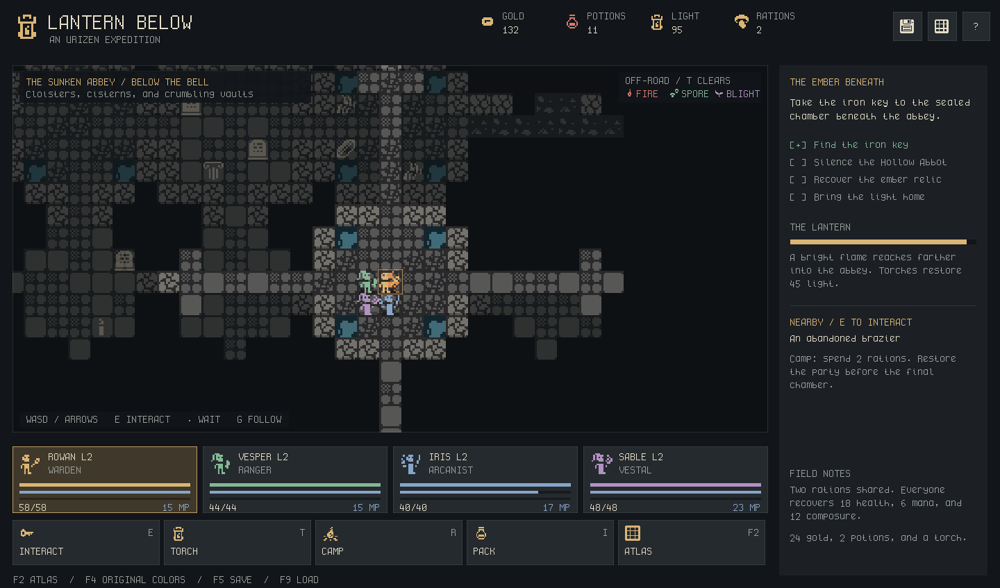
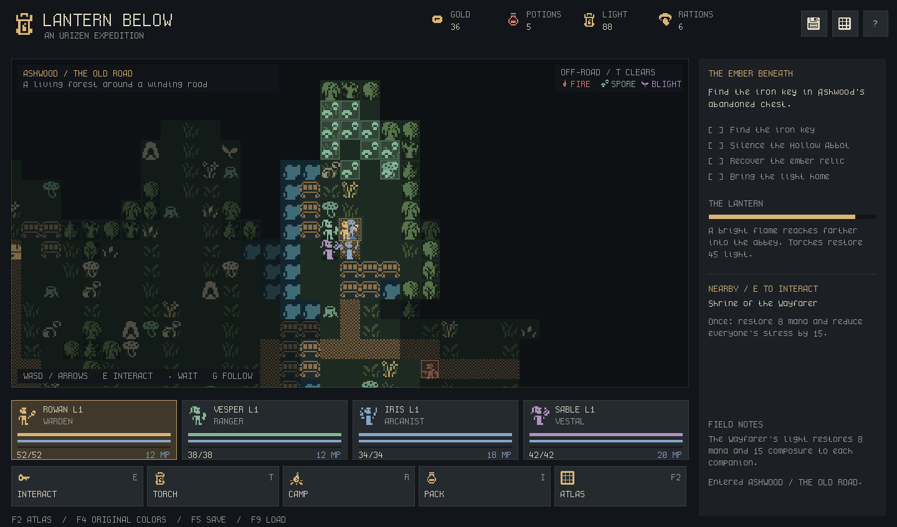

# Legacy preview procedural generation

This records the retained fantasy preview and its original quest guarantees. Current lunar generation is documented in [PROCEDURAL_GENERATION.md](PROCEDURAL_GENERATION.md).

New RPG expeditions use a reproducible hybrid generator. Hearth keeps its streets, houses and services; Ashwood gets cellular forest/pond terrain and reserved routes; the Abbey gets a connected room graph, socket-based Wave Function Collapse (WFC), and cellular erosion. The original five encounters and return-home quest remain playable. The colony simulation is currently independent.



```sh
./rpg.sh --seed 42
./rpg.sh --seed 1337 --scene forest
./rpg.sh --seed 7 --scene crypt
./rpg.sh --generation-report --seed 42
./rpg.sh --validate-seeds 1000 --seed 0
./rpg.sh --headless --seed 1337
```

Report, validation and headless modes open no window and write no player save. `--validate-seeds N` checks consecutive signed 32-bit seeds, wrapping deterministically at the integer boundary; N must be 1–10,000. The report includes dimensions, terrain counts, algorithm/version, every room's sockets/style, WFC observation/propagation counts, fallback status and quest validation. Preview scenes do not autosave. Loading an existing expedition preserves its maps instead of applying a new seed.

## Generation stages

| Area | Structural generation | Presentation and playability |
| --- | --- | --- |
| Hearth, 36 × 26 | Authored houses, roads, NPCs and exit | Seeded floor/tree choices and furnishings, clear service approaches, no hazards |
| Ashwood, 48 × 32 | Four eight-neighbor cellular passes for trees; three for ponds; a continuous meandering river | Seeded key, shrine, camp and encounter positions; winding main road and branches carved afterward; water crossings become bridges; reserved routes and clearings exclude hazards |
| Sunken Abbey, 51 × 37 | A 7 × 5 graph of 7 × 7 room chunks; WFC assembles matching arches and sealed walls | Cloister/cistern/collapsed styles; optional extra connections; cellular erosion in collapsed rooms, water in cistern corners; protected room crosses; isolated boss room behind one seal |

Forest birth requires at least five occupied neighbors; occupied cells survive with four. Edges count as occupied and every pass reads an unchanged previous generation. Initial tree coverage is 47%; pond coverage starts at 42%. Initial coverage is not the final terrain percentage. Pond placement is restricted to off-road north/south bands before route carving. The rules are game-like terrain masks, not a simulation of plant biology or water flow.

The Abbey first reserves a short west/east route and grows seeded branches until every room belongs to one connected graph. The boss room is a leaf: its western seal is its only connection. WFC may add loops elsewhere. Every room retains a clear center and cross; erosion never cuts arches or the inner formation space. Encounters in Abbey rooms place all combat units within two Manhattan cells of their marker. Battle positions remain presentation; tactical walking/range is not implemented.

## WFC contract

The implementation follows the constraint/observation approach described by the [original WFC project](https://github.com/mxgmn/WaveFunctionCollapse). It is a small C# solver in Core and adds no engine or package dependency.

- Socket order is north, east, south, west; `0` means sealed masonry and `1` means a centered one-cell arch. A neighbor must expose the same opposing socket.
- There are 15 nonempty connection masks and three visual/shape variants, giving 45 room tiles. These masks are **authored room connections**, not bitmasks recovered from Urizen sprite indices.
- Mandatory graph edges must be open. Outside boundaries and the boss chamber's other edges must be closed. Other edges remain choices for WFC.
- The solver stores domains and precomputed compatibility sets in 64-bit bitsets. It propagates restrictions through a queue, selects a cell by weighted Shannon entropy, and makes a seeded weighted observation. Weight is the style weight multiplied by `5 − number of open sockets`, favoring fewer optional connections.
- Cloister/cistern/collapsed style weights are 5/3/2. All use the same arch contract; style changes do not imply incompatible connections.
- Contradictions restart from the original domains with a derived seed, up to eight attempts. There is no unbounded retry or backtracking. Exhaustion uses exact graph sockets and plain cloister rooms; diagnostics record that fallback.

Global connectivity comes from the graph and subsequent validation, rather than from WFC's local rules alone. Generation validates object footprints, duplicate IDs/positions, portal arrivals/destinations, encounter-free approaches, access to the key/camps/return route, boss and relic isolation with the seal locked, and access after unlocking it. Routes avoid unintended encounters and portals. A failed world validation uses the retained authored world and records the reason; an invalid fallback throws instead of launching a broken quest.

## Cellular hazards during exploration



Hazards use a separate four-neighbor automaton with reusable next-state buffers. They update **every four successful steps or waits in the active area**, not every rendered frame. Menus, blocked movement, camps, combat and inactive areas pause their evolution. Period or Space waits one exploration turn.

| Hazard | Source and evolution | Cost on an occupied tile |
| --- | --- | --- |
| Fire | A woodland ignition near the camp, separate from its campfire. Spreads to eligible neighbors with fuel; burns for at most five ticks per ignition. Fuel is finite. Exhausted trees show the dead-tree crop; grass shows grit. | Conscious companions lose 1 HP and gain 1 stress per step/wait |
| Spores | Persistent source near a shrine/cistern encounter; four-tick clouds spread over walkable cells, decay and may return around the source. | Conscious companions lose 1 HP and gain 1 stress per step/wait |
| Corruption | Persistent source near an encounter; seven-tick growth spreads over walkable cells and cycles around its source. | Conscious companions gain 3 stress per step/wait |

Spread uses a deterministic hash of seed, cell and environment tick; it never consumes combat RNG. Fire, spores and corruption use distinct silhouettes and colors, with hover explanations. Hazards cannot take a conscious hero below 1 HP. They do not alter terrain collision. Fire fuel depletion changes presentation, not the route graph. Existing scenery and campfires do not automatically become hazard sources.

Road corridors, objective clearings, room crosses and objective approaches are protected. Hazards never occupy those cells. Click routing prefers hazard-free paths, and manual movement can enter a hazardous tile. **T** spends one torch to restore up to 45 light and clear hazards/sources within three Manhattan cells, even at full light when a hazard is nearby. Cleared sources are removed permanently; the area is protected from regrowth for eight hazard ticks. This is the lantern's magical ward, not a physical fire/air simulation.

## Assets and authoring

[assets/ithica-generation.json](../assets/ithica-generation.json) is the authoritative generation rules file, embedded into `Ithica.Core` at build time. It defines CA settings, material sprites/fuel, biome dressing, room styles/weights and hazard aliases. Editing it requires a rebuild; catalog regeneration alone does not change an already built executable.

Source PNGs and existing IDs/crops are unchanged. [The Urizen generation review](../assets/reference/urizen-generation.md) documents 104 individually inspected crops, including uncertain fragments and unused candidates. The retained schema-3 generation extension adds `generation` to every indexed region, distinguishing `runtime_rule`, `candidate_requires_rules`, `not_world_generation` and `not_applicable`. The native F2 and offline HTML viewers show/search the new notes; search `runtime_rule`, `cistern`, or `visual review`.

Only curated aliases enter generation. The generator does not infer joins, collision, animation or species from arbitrary sheet coordinates. Boulders, grave markers, crystals and cave mouths in generated scenery are nonblocking decorations. They do not imply mining, another playable cave area or a resource economy. Unknown author labels retain their existing identity confidence even when cast for a game role.

To extend a theme: inspect the exact crop and neighboring fragments, add an alias, author its material/style/placement rules, and regenerate the catalog. For new room geometries, preserve the arch positions, safe cross and formation space, then run seed validation and full expedition tests. Raw scene-lab recipes remain design experiments; they are not automatically imported as WFC samples.

```sh
python3 tools/build_game_catalog.py
./tools/dotnet.sh build Ithica.sln --configuration Release
./tools/dotnet.sh test Ithica.sln --configuration Release --no-build
./rpg.sh --validate-seeds 1000 --seed 0
python3 tools/build_game_catalog.py --check
```

## Saves and performance boundaries

Version-two saves contain the actual generated tile arrays, selected ground sprites, objects, safe masks, discovery data, generation report, hazard cells/ages/fuel/sources/suppression, local turn/tick counters, party, quest, combat and random state. Loading restores those maps; future generator changes do not reroll an expedition. Version-one saves reconstruct the exact old authored maps without enabling hazards, and can then be resaved with full version-two snapshots. Active battles continue exactly across a save/load.

Named seed streams separate terrain, graph/WFC, dressing, hazards and combat. A generator change may produce a different **new** world from an old seed; the generator version and saved authoritative maps make that distinction explicit.

Generation runs once at campaign creation, with 35 WFC domains rather than one domain for every source sprite or world cell. Exploration updates flat per-area arrays at turn cadence; render work stays bounded by the viewport. This is a three-area generator, not an infinite world streamer or a large-agent performance benchmark. Larger maps, new objectives or dynamic blocking terrain require renewed profiling and reachability checks.

## Local verification

Checked on macOS Intel on 2026-10-20:

| Check | Result |
| --- | --- |
| Release build | No warnings or errors |
| Core tests | 97 passed: 41 colony, 56 RPG |
| Consecutive procedural seeds −500 through 499 | 1,000 playable layouts; zero fallback zones |
| Real complete expeditions | 36 finished, including negative/zero seeds and both 32-bit extremes; paid actions and no debug grants |
| RPG native/published smoke | 17 checks passed at 1024 × 720; published build launched from outside the repository |
| Colony native smoke | 12 checks passed |
| Offline atlas | 14 checks passed, including generation search, crop observations, exports and narrow-window layout |
| Catalog/original assets | Deterministic output current; all 664 original PNG and three ZIP hashes match |

CI includes headless seed validation on its desktop OS matrix. Graphical verification above is local macOS testing, rather than a claim of native graphics testing on all platforms.
