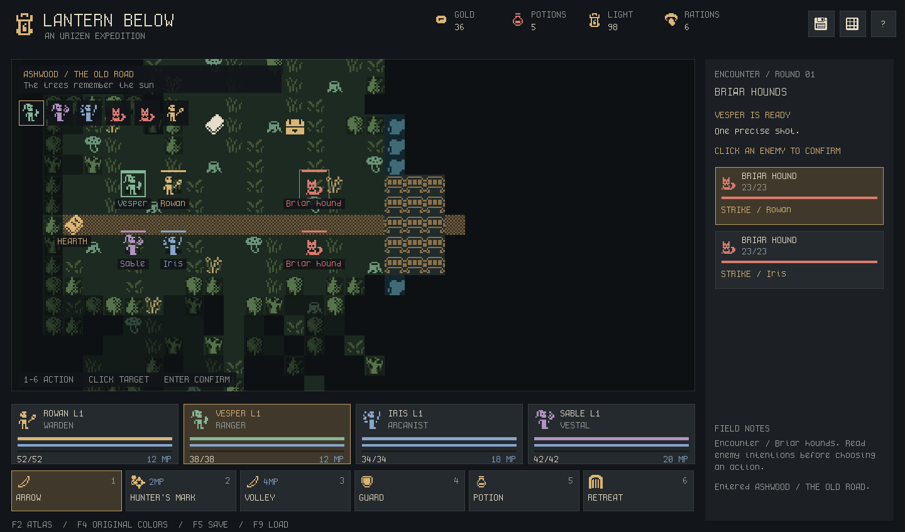

# Legacy fantasy RPG preview

This is the preserved regression/art-exploration prototype. It is separate from the normal Ithica campaign and retains old fantasy content/save identities. Use [EXPEDITIONS.md](EXPEDITIONS.md) for the current lunar game.

This playable party RPG explores the same artwork as the colony prototype. Exploration and battles are both **top-down**. Four companions travel from Hearth through Ashwood into the Sunken Abbey, recover an ember relic, and return it to town. The colony simulator remains independently playable with `./play.sh`.




## Run

Requires the same .NET 10 SDK as the colony prototype. From the repository:

```sh
./rpg.sh
./rpg.sh --load
./rpg.sh --demo
./rpg.sh --scene forest
./rpg.sh --scene crypt
./rpg.sh --scene atlas
```

On Windows: `dotnet run --project src/Ithica.Client --configuration Release -- --preview`. The shell launcher is optional and works from any directory. Default window: 1440×900; minimum: 1024×720. `--window-size 1280x800` sets another initial size.

The four-page field guide opens before play. F1 reopens it. Closing the window or Q saves to `~/.regolith/lantern.json`. `--save PATH` selects another file. This format is separate from colony and archived Python saves.

Preview scenes (`--demo` and non-town `--scene` values) save only when you explicitly press F5/Ctrl+S, so browsing the atlas or a combat example preserves your existing expedition. Outside the atlas, loading a save with F9 resumes normal autosaving.

## Controls

| Input | Action |
| --- | --- |
| WASD / arrows | Move one tile; hold to continue |
| Left click | Walk to visible terrain or approach/interact with an object |
| E / Enter outside combat | Interact with the current/adjacent object |
| Mouse wheel over map | Zoom around pointer |
| Right / middle drag | Pan |
| + / −, Page Up / Down | Zoom around party position |
| G / 0 | Follow party again / reset zoom and follow |
| 1–3 in battle | Choose a class skill |
| 4 / 5 / 6 in battle | Guard / potion / retreat |
| Click an enemy / companion | Confirm the selected targeted action |
| Tab / Right in battle | Cycle targets |
| Enter / Space in battle | Confirm selected target |
| Click a party card outside battle | Select a companion |
| H outside battle | Spend a potion on selected companion |
| T / R | Burn a torch and ward nearby hazards / rest at a campsite |
| Period / Space outside battle | Wait one exploration turn |
| I / J | Shared pack / expedition journal |
| F1 / F2 / F4 | Guide / complete asset viewer / original colors |
| F5 or Ctrl+S / F9 | Save / load, including mid-combat |
| F11 / Q | Fullscreen / save and quit |

Menus and the atlas pause automatic enemy actions. Gameplay has no real-time survival timer: exploration advances only when moving and combat advances by turns. Repeated movement into walls does not consume light.

## Expedition route

Start in **Hearth** with 36 gold, 5 potions, 4 torches, and 6 rations. Warden Elowen explains the quest. The inn fully restores the party for 12 gold. The provisioner sells two potions, two torches, and two rations for 10 gold. Move through the eastern sign to Ashwood.

In **Ashwood**, red encounter markers show enemies before combat; they are not random invisible rolls. A chest along a northern road branch contains the iron key; its position changes with the seed. A nearby shrine restores mana and composure once. A campsite farther east spends two rations to restore health, mana, and composure. The eastern steps enter the abbey. Optional fights earn levels and supplies before the boss.

In **the Sunken Abbey**, sight is occluded by walls and previously seen rooms remain mapped. Northern branches hold the faithful dead, southern branches a cistern encounter and brazier, and the entrance room a strongbox. The generated room connections and styles vary by seed. The iron key opens the eastern seal. Defeat the Hollow Abbot, interact with the ember relic behind him, and return through Ashwood to Elowen. The completed expedition remains playable.

Defeat brings everyone back to Hearth at partial health/mana, adds stress, and removes a quarter of current gold. It preserves looted chests, cleared fights, opened gates, and exploration. There is no permadeath or campaign deletion in this prototype.

## Procedural areas and hazards

New campaigns generate Ashwood forests and ponds with cellular automata, and assemble 35 Abbey rooms using a connected quest graph and socket-based WFC. Hearth keeps its layout with seeded furnishings. Routes, the key, camps, portals and the locked boss chamber are checked before play. Use `--seed N` to explore another world. [Generation design, rules and diagnostics](PROCEDURAL_GENERATION.md) explain the full pipeline.

Off-road fire, spores and corruption evolve every four successful steps or waits in the active area. Period or Space waits. Fire/spores cost 1 health and 1 stress; corruption costs 3 stress. Roads, room crosses and objective approaches stay safe. T spends a torch to clear hazards and their sources within three Manhattan cells, even at full light when needed. Hover a visible hazard for its rules. Combat, menus, blocked moves and inactive areas pause hazard evolution.

Version-two saves preserve actual maps and evolving fields. Existing version-one saves retain their original authored layouts without hazards; start a new expedition to see the new generator.

```sh
./rpg.sh --generation-report --seed 42
./rpg.sh --validate-seeds 1000 --seed 0
```

## Party and battle rules

| Companion | Class | Skills |
| --- | --- | --- |
| Rowan | Warden | Longsword; shield bash with stun; party guard/composure rally |
| Vesper | Ranger | Arrow; hunter's mark for bonus damage; volley against all enemies |
| Iris | Arcanist | Free wand attack; ember with burning; chain arc against all enemies |
| Sable | Vestal | Smite; mend to heal/revive and stop bleeding; party stress relief |

Every class also guards, uses shared potions, or retreats. Skills validate targets and mana before spending resources. Enemies display their next intent and target. Initiative uses speed with small seeded tie variation each round. Turn order is visible above the battlefield. Battles use distinct map positions, but there is no tactical walking/range/flanking system: position is presentation, and single-target attacks may target any living enemy.

Guard halves incoming damage until the unit's next turn. Burn and bleed deal damage at turn start. Stun skips a turn. Mark increases incoming attack damage. Stress at 80 or more weakens attacks, and low light increases enemy-induced stress. Torches restore 45 light; dark exploration reduces sight. Defeated party members can be revived by mend, a potion, camp recovery, or resting. Victory awards gold, XP, and a potion. Levels increase health, mana, and attack strength.

## Explore the sprites

Press **F2** inside the game, or run `./rpg.sh --scene atlas`. Type to search neutral artwork descriptions, subjects and IDs. Typed filters include `subject:ghost confidence:high` and `color:green type:actor`. Game interpretations/ideas require the optional Game notes control or `game:true`. F3 cycles packs, F6/Tab types, F8 colors, F10 sorts and F7 optional usage; Shift reverses cycling. F1 opens query help, F9 resets filters, and F4 switches the preview palette. Arrows select entries; Page Up/Down or the wheel pages through the grid. Scroll over the detail panel to read long notes. Esc clears search, then returns to play; F2 also returns directly.

The native viewer has all **7,115 occupied regions** from Urizen, Godot node icons, and keyboard/controller prompts. Merely registering or viewing an image is not counted as a gameplay binding. Some entries are fragments, uncertain figures, or sparse marks, rather than independently usable objects. Controller art is available for inspection; controller input is not implemented.

Open [the offline atlas](../assets/atlas.html) for more filters and a **scene lab**. Pin sprites to a palette, paint separate ground/prop/actor layers, erase with the right mouse button, and export JSON recipes or PNG previews. The HTML embeds its data and original images, so it works directly from disk without a server or canvas cross-origin exceptions. Recipes retain exact stable IDs rather than copying/repacking source artwork.

## Code, catalog, and checks

`Ithica.Core.Expeditions` owns maps, collision, line of sight, party state, interaction, turn resolution, loot, quest progression, seeded random state, and atomic save files. It has no MonoGame dependency. `Ithica.Client/Preview` owns input, interpolation, top-down rendering, battle/party UI, and the native asset viewer. The normal game and preview use `Ithica.Graphics` for sprite decoding, bitmap text, palette masks, and camera transforms; the preview campaign remains independent from the normal shared campaign.

The [binding table](../assets/reference/rpg-bindings.md) lists every RPG alias and source identity. [Catalog schema](../assets/reference/CATALOG_V2.md) explains exhaustive coverage, usage, evidence, and uncertainty. The original artwork, crop IDs, colony selection, and import audit are unchanged.

```sh
./tools/dotnet.sh build Ithica.sln --configuration Release
./tools/dotnet.sh test Ithica.sln --configuration Release --no-build
./rpg.sh --headless
./rpg.sh --smoke-test --screenshot /tmp/lantern-smoke.png
python3 tools/build_game_catalog.py --check
```

The headless driver completes a real expedition through movement, interactions, paid skills, camp costs, boss combat, and return-home progression. It does not grant items or victory through debug state. Core tests cover this on several seeds, plus hundreds of generated quest layouts, WFC constraints/fallback, cellular hazards, legacy saves, collision, visibility, gate/chest rules, battle validation, guard, stress, healing/revival, burning, defeat, retreat, and exact save continuation. The native smoke opens a real window and checks the viewer, transition, combat, zoom, saves, and full quest before exiting without touching the player's save.

Capture other views with `--scene town|forest|crypt|battle|victory|atlas --screenshot PATH --frames 12`. Local distribution: `./tools/dotnet.sh publish src/Ithica.Client --configuration Release --self-contained false --output artifacts/ithica-preview`. The output needs .NET 10 and includes all source images required by its viewer, the lightweight atlas index, runtime manifest, and credits. The larger audit/catalog stays in the repository.

This is a generated three-area vertical slice around a planned quest graph, with five encounters and one finite quest. Equipment is class-defined; item hauling, gear swapping, dialogue branches, shops with individual wares, branching procedural campaigns, directional sprite animations, tactical movement, and gamepad controls are future work. Maps use single-cell sprite interpretations, not an inferred autotile/animation system. Native graphics have been exercised on macOS Intel; other desktop platforms still need graphical verification.
