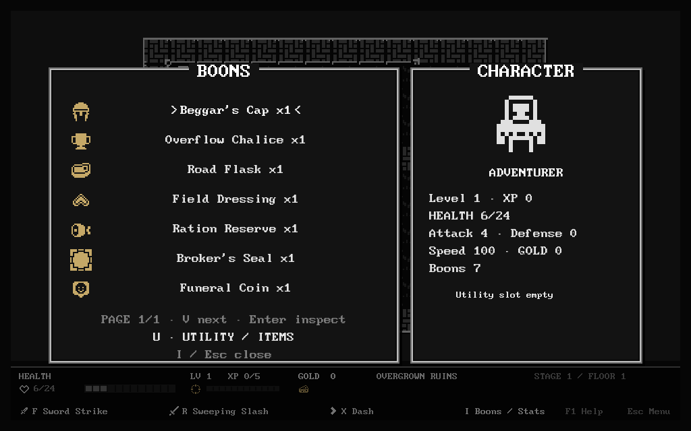
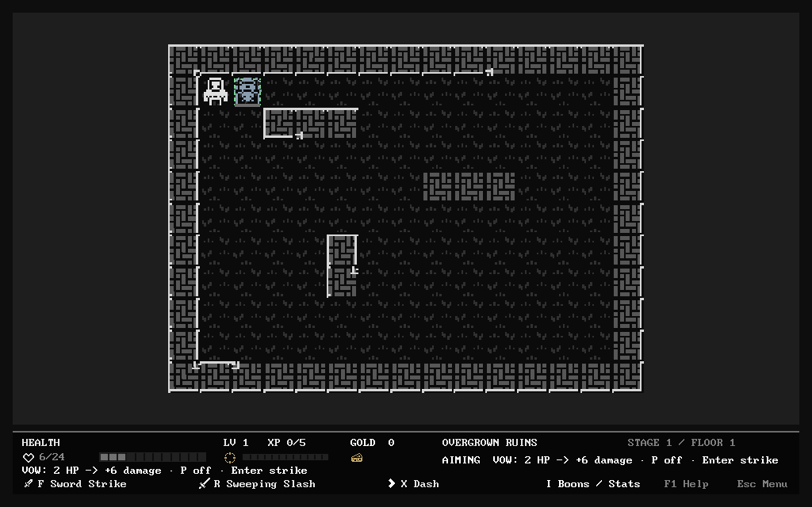

# Approved additional boons — implementation and acceptance

## Scope and current state

The resumed goal requires **50+ additional distinct boons**, followed by final
integration/visual acceptance. The starting catalogue contained 53 boons.
**Eight additions are implemented so far: 61 total, 57 in a normal unearned
New Run pool, plus the four existing achievement unlocks. At least 42 more
additions are still required.** This first group does not complete the goal.

Pilgrim is an implemented **boon**, never a new class. Its explicit HP payment
appears in the preview and cannot kill the player. Oracle's
redirect remains the pending dice boon: six numbered outcomes, skull and miss;
skull kills regular enemies only, never minibosses, the finale or special
reward-exempt encounter actors. The rejected Oracle room and Cantor class stay
rejected. Cantor's requested hat 33 and cup 824 now have the uses below.

Remaining groups will cover positional attack shapes/movement, limited control,
terrain/status interactions, defense/cadence, and the vow/dice redirects. Each
addition needs an actual tactical difference, accurate text and artwork, real
action tests and saved-state continuation. Renamed damage bonuses do not meet
the requested distinct-mechanic requirement.

## First group: supplies and rewards

Values are **Common / Uncommon / Rare / Legendary per copy**. Mixed rarity
copies sum their declared power without an ownership cap. Definitions live in
`src/idea_boon_content.lua`, appended after all 53 earlier IDs.

| Boon / native icon | Committed behavior | Power C/U/R/L |
| --- | --- | --- |
| Beggar's Cap / 33 | A gold pickup at half health or lower grants a one-hit ward for 300 world time | 2 / 3 / 4 / 6 absorbed damage |
| Overflow Chalice / 824 | Capture actual wasted food/health healing as a one-hit ward for 400 time, capped by power | 2 / 3 / 4 / 6 maximum captured healing |
| Road Flask / 965 | Eating food grants speed for 300 time; repeat food refreshes the duration | 10 / 15 / 20 / 25 speed |
| Field Dressing / 1052 | A health pickup removes real Burning and its queued tick, then grants capped bonus healing; food does neither | 1 / 2 / 3 / 4 bonus HP |
| Ration Reserve / 817 | Food stores one recovery charge for 600 time; the next Wait spends it to heal, including a zero-gain Wait at full HP | 1 / 2 / 3 / 4 HP |
| Broker's Seal / 489 | Refund gold **after** a paid chest purchase, capped by its price; full affordability is checked first | 1 / 2 / 3 / 4 maximum refund |
| Funeral Coin / 773 | A credited kill enriches that victim's existing normal currency drop; collect it normally later | 1 / 2 / 3 / 4 extra gold |

These are configurable provisional values, not a claim of completed balance
acceptance. No pre-existing boon, enemy, class, chest price, terrain or scheduler
parameter changed in this group.

### Limits and interactions

- Supplies remain finite drops. Full-health supplies remain on the ground and
  cannot be consumed repeatedly for free buffs. Overflow captures only wasted
  healing from an actually consumed supply, never its full nominal amount.
- Separate active wards are consumed in catalogue order until a hit is covered.
  Later wards remain intact if unnecessary. A touched ward is spent on that
  one positive hit; defense or an earlier ward blocking everything does not
  spend later wards. Ordinary damage retains its existing windup semantics.
- Repeat activation retains the larger **unexpired** ward and refreshes its
  duration. An expired large ward cannot be revived by a smaller new capture.
- Food speed adds to Bloodrush. The action that consumed food uses its already
  committed cost; only later actions use the new speed. Buff expiry uses world
  time, never rendering `dt`.
- Ration Reserve stores one charge, not one per stack/pickup. Waiting still
  spends a normal action and can expose the player to committed enemy attacks.
- A refund is `CurrencyRefunded`, not another `CurrencyCollected` event. It
  cannot recursively trigger pickup healing, waive initial affordability,
  exceed the price or reopen a claimed chest. Free chests give no refund.
- Funeral Coin creates no second kill, XP award or automatic pickup. Called,
  resurrected and other reward-exempt enemies cannot farm bonus gold.
- The seven new effects themselves draw no gameplay RNG. New runs intentionally
  have a wider offer pool; existing runs retain their saved pool and RNG.

## Runtime, art and persistence

The existing event subscriptions, ancestry protection, simultaneous primary HP
batch and effect queue resolve the additions. The small shared resolver gains
validated supply/event predicates, cleansing, a bounded purchase refund and
existing-drop enrichment. Timed state remains compact plain `boon_memory` data.
Speed/ward lookup now visits that memory in the catalogue's stable order,
preserving the old Bloodrush/Betrayal Ward behavior when no new boons are owned.

The boon content version remains `roag-boons/3`: this is additive data using the
existing memory/save contracts, with no save migration. The first 53 IDs and
the original starter/unlock boundaries remain intact. A pre-change executable's
checked save is also continued under the new code to test compatibility rather
than assuming a new-to-new round trip proves it.

Icons use untouched native Kenney 1-Bit regions, the existing Image/Quad reader
and muted gold presentation ink. Every new boon has both `/icon` and `/detail`
bindings. Current coverage is **507/507** with no missing bindings and the same
13 approved monochrome cross-sheet counterparts. The live HTML/JSON/CSV
catalogue is regenerated; frozen review/feedback archives and source PNGs are
unchanged.



## Pilgrim's Vow: explicit HP-for-power attack

The eighth addition uses native hooded figure **318**. While aiming an immediate
attack with **F/R**, press **P** (controller **LB**) to toggle the vow. The preview
shows **2 HP -> +damage**; **Enter/A** commits, **Esc/B** cancels for free. A
committed vow spends 2 current HP once and adds **3/4/6/8** primary damage per
copy before criticals/defense. The payment must leave at least 1 HP. It is a
cost, not a damage event: wards, invulnerability and retaliation cannot turn
arming/canceling into healing or avoid the price. A miss still spends the cost.

All 15 existing classes can vow on their basic attack. Immediate damaging
specials and an actual commanded Spirit strike also support it. Parry, decoy,
snare/block/sentry/beacon placement and delayed Stormcaller discharge refuse
payment; Dash, walking, bump attacks, item use, menus and waits never silently
pay. A single payment empowers the whole primary sweep batch, then expires.
It does not persist as a buff or add bonus damage to later Echoes/attacks.
The already scheduled recovery and enemy impact ordering remain unchanged.

Rarity stacks add damage, not additional HP payments. Normal kill healing can
still synergize with the paid attack. The toggle lives only in the presentation
aim state; committed HP/action state uses the existing snapshot/save contract.



## Reproducible checks

```sh
TMPDIR=/var/tmp luajit tests/run.lua
sh tests/idea_boon_disk_resume.sh
TMPDIR=/var/tmp sh tests/idea_boon_gui_smoke.sh
python3 tools/sprite_audit.py --check
git diff --check
```

`tests/idea_boon_tests.lua` adds 22 focused cases, including actual gold/food/
health/chest/kill actions, stack/cap/expiry boundaries, cleanse scheduling,
preview purity, exact pending Burning/Echo continuation and malformed-data
rejection. The GUI harness renders all new inventory icons and checks opaque
source pixels against the GPU screenshot, opens details, and commits real
food/gold/health pickups through the game's key callbacks. The inventory is a
prepared fixture, **not** an earned ordinary-action full run.

Screenshot callbacks only hand off the captured image. Checks and disk writes
run during a protected update, so a failed assertion becomes a retained log and
nonzero exit rather than an uncaught screenshot callback exception. This does
not establish a root cause or fix for historical unrelated LÖVE crashes.

Resume baseline: **647 passed, 0 failed** from frozen source, log
`/var/tmp/roag-boons-resume-baseline-retry-20261019.log`. The first interrupted
attempt ended with signal 143 and is retained at
`/var/tmp/roag-boons-resume-baseline-20261019.log`; it is not counted as a pass.
The seven-addition full gate passes **669/669**, 519.52 s / 156,700 KiB peak
LuaJIT RSS; log `/var/tmp/roag-idea-boons-supplies-retry-full-20261019.log`.
An earlier updated run was 668/669 because an achievement test still expected a
fixed 50-entry pool. The corrected test retains the legal elite/profile/unlock
offer proof and passes in the clean full retry. With Pilgrim, the new focused
cases are **36/36** (22 supply/reward + 14 vow/compile), and combined boon,
artwork, environment, settings and palette checks are **101/101**. Its updated
683-case full gate remains pending until recorded in the progress ledger.

Pilgrim also passes three independent GUI processes for actual keyboard aim,
cancel, payment and ordinary follow-up, plus controller LB callback verification
and the native two-page inventory/detail check. One attempted GUI exposed
LuaJIT's 60-upvalue compile limit when adding a module alias to `keypressed`;
the fix uses its cached module without adding another captured alias, and a
headless real-main compilation regression catches recurrence. The failed log
`/var/tmp/roag-idea-boon-gui-WTu62Y/love.log` is preserved. This was a Lua load
error/error-screen timeout, not an unexplained native crash.

New-to-new disk cases pass for both supply state and legacy boon state. A separate
legacy case was written by frozen pre-change source and continued by current
source with byte-identical subsequent events and snapshots, using pending
Burning/Echo and the older 49-ID pool.

Actual GUI verification uses LÖVE **11.5**, OpenGL 4.6 Mesa **26.2.4 llvmpipe**
(LLVM 22.1.8, 256 bits) on Fedora WSL. This is callback-driven software rendering,
not human play, physical keyboard/mouse/Wacom input or native GPU performance.
All saves/screenshots/logs live in isolated `/var/tmp/roag-*` directories.

### Still required for final acceptance

- Finish the remaining 42+ boons, including dice, and verify
  every mechanic/shape/preview, rarity/stack rule, icon and saved state.
- Re-run the complete integrated headless, seed/replay, fresh-process save,
  ordinary-action Victory, class/route and reward/balance gates after all changes.
- Run repeated actual GUI groups for the existing game and all approved enemy,
  class, item/room, terrain and environment work, at both supported viewport
  sizes. Keep failures and distinguish fixture assertions, timeouts and crashes.
- Check actual burst/readability/performance. This first GUI already shows two
  presentation follow-ups: the character panel currently lists base speed rather
  than temporary speed, and capped extra healing can produce zero-gain notices.
- Human gameplay and physical input acceptance remain explicitly outstanding.

## Primary references

- [Lua 5.1 `next`: traversal order is unspecified](https://www.lua.org/manual/5.1/manual.html#pdf-next). Simulation effects use explicit catalogue/array ordering.
- [Kenney 1-Bit Pack](https://kenney.nl/assets/1-bit-pack). CC0 source art; local checked PNG regions remain the mapping authority.
- [LÖVE `captureScreenshot`](https://www.love2d.org/wiki/love.graphics.captureScreenshot). Capture is queued for the frame; assertion handling is outside its callback.
