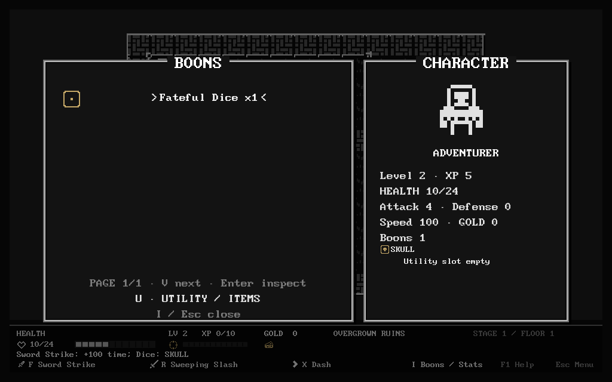

# Approved additional boons — implementation and acceptance

## Scope and current state

The resumed goal requires **50+ additional distinct boons**, followed by final
integration/visual acceptance. The starting catalogue contained 53 boons.
**All fifty additions are implemented: 103 total, 99 in the normal unearned
New Run ID list, plus the four existing achievement unlocks. Final combined
integration/acceptance is still in progress; the sustained goal is not complete.** These groups do not complete the goal.

Pilgrim is an implemented **boon**, never a new class. Its explicit HP payment
appears in the preview and cannot kill the player. Oracle's
redirect is Fateful Dice: six numbered outcomes, skull and miss;
skull kills regular enemies only, never minibosses, the finale or special
reward-exempt encounter actors. The rejected Oracle room and Cantor class stay
rejected. Cantor's requested hat 33 and cup 824 now have the uses below.

Remaining groups will expand terrain/status interactions, defense/cadence and
skill transformations. Each
addition needs an actual tactical difference, accurate text and artwork, real
action tests and saved-state continuation. Renamed damage bonuses do not meet
the requested distinct-mechanic requirement.

## Positional patterns and a locked Dash wake

All eight use **1 / 2 / 3 / 4 damage per cell before defense**, per copy at
Common / Uncommon / Rare / Legendary. Powers are provisional pending the final
reward/build corpus. Geometry is bounded, deterministic and independent of RNG.
The starting catalogue, existing actors, enemy schedules and base costs remain.

| Boon / native icon | Actual trigger and geometry |
| --- | --- |
| Linebreaker's Pawn / 1021 | Each positive primary hit sends two cells beyond the victim, away from the real strike origin |
| Rook's Wake / 1023 | Cardinal primary hits send two perpendicular rays, two cells per side |
| Bishop's Wake / 1024 | Diagonal primary hits send four diagonal rays, two cells each |
| Knight's Gambit / 1027 | Positive special hits strike eight L endpoints; at least one of the two orthogonal leg orders must be clear |
| Hollow Crown / 816 | Credited hostile kills strike the hollow Chebyshev radius-two perimeter; the center and inner ring are spared |
| Crosswind / 584 | A paid Wait sends four cardinal two-cell rays from the current player tile |
| Fan of Blades / 39 | Positive special hits strike three forward fan cells beyond the victim |
| Backtrail Mantle / 87 | An actual full or partial Dash locks the starting cross (center + four neighbors), resolving after 150 world time |

`src/boon_patterns.lua` is shared by actual effects and conditional previews.
Rays stop at walls, closed doors and projectile-blocking objects. Diagonal
corner checks and short supercover segments prevent leaks through masonry.
Knight endpoints use explicit bending paths, not an unannounced wall jump.
Victim-triggered effects occur after the complete primary HP batch and use
ordinary defense, ward, forcefield, friendly-fire and ancestry rules. Secondary
pattern damage is not another direct attack. Utility/parry/placement never
pretends to be a special hit. A commanded Spirit uses its actual strike origin.

While F/R/X aiming, applicable **visible** conditional cells use the same green
dotted outlines as primary previews; the footer says `on hit`, `on kill` or
`Dash wake +150 time`. These are explicitly conditional, not guaranteed damage
or predictions of Dice, defense or forcefield outcomes. No hidden primary victim
or fogged cell is displayed. Wait commits immediately, as before; Crosswind has
no extra aiming mode. A pending wake remains outlined in green after Dash.

Backtrail copies its activation before replacing locked cells, so it cannot
mutate the shared triggering event or a Temporal Echo. Walking, escape-scroll
movement and Wayfinder beacon returns do not trigger it. Impact keeps the
original cells if the player moves; save/Continue and F5 retain them exactly.

## Control and resource conversions

| Boon / native icon | Committed behavior | Power C/U/R/L |
| --- | --- | --- |
| Grasping Hand / 1054 | Positive special hits on regular foes in the owner's row/column add defended damage, then pull surviving victims one cell toward the owner | 1 / 2 / 3 / 4 bonus damage |
| Anchor Maul / 1055 | Cardinal-adjacent basic hits push a regular foe one cell; a blocked push deals collision damage instead | 1 / 2 / 3 / 4 collision damage |
| Hourglass Clasp / 1072 | First surviving regular primary victim is stunned; one trigger per attack and a 400-time cooldown | 10 / 20 / 30 / 40 stun time per copy, capped at 100 |
| Ward Ledger / 854 | A paid Wait while hurt consumes active one-hit wards for capped healing; consumed wards lose unused capacity | 1 / 2 / 3 / 4 maximum healing |
| Cinder Stopper / 916 | A primary hit on an already Burning foe consumes its remaining Burning for one capped fire hit; its exact queued tick is removed | 3 / 5 / 7 / 10 captured damage before defense |
| Scavenger's Hook / 1053 | A paid Wait gathers adjacent clear/visible pickup tiles in N/E/S/W order; normal pickup rules and effects apply | 1 / 2 / 3 / 4 tiles, naturally capped at four |

The three control boons exclude minibosses, the finale, pursuer, special
encounters and reward-exempt actors. Displacement uses existing collision,
stairs/exit protection and windup cancellation. Hourglass never brings a later
recovery forward, does not guarantee a player reaction turn, and uses saved
world-time cooldowns that rebase correctly at stage handoff. Uncapped mixed
rarity ownership remains; its disclosed stun cap is separate from stack count.

Ward conversion cannot farm empty/expired wards or waste wards at full health.
Burning conversion only triggers when Burning existed at the primary hit;
ordinary Emberbrand can subsequently ignite the foe again. Collection leaves
full-health food, carried drops, blocked tiles and other floors alone. It never
silently changes food's 4 HP or health pickups' 10 HP. These effects add no
render timers, extra inputs or gameplay RNG draws.

Owner-based pulls deliberately use the owner's alignment even when a commanded
Spirit also owns strike-origin pattern boons; a regression checks that adding
Linebreaker's Pawn cannot change Grasping Hand's eligibility.

## Class weapon forms

These seven use existing F/R controls and alter primary cells rather than adding
an invisible follow-up. The class requirement applies to normal offers. The
normal ID list is frozen into a run as before; each chest still filters offers
for that run's actual class.

| Boon / native icon | Class / input | Actual primary change | Bonus C/U/R/L |
| --- | --- | --- | --- |
| Pommel Return / 1026 | Adventurer / aimed F | Adds the clear cell directly behind the player; composes with Longblade; bump stays narrow | 1 / 2 / 3 / 4 |
| Needle Flight / 1063 | Ranger / aimed F | Pierces the clear four-cell ray and keeps valid Splitflight branches; bump does not gain this piercing | 1 / 2 / 3 / 4 |
| Hollow Sigil / 930 | Arcanist / R | A fully placed sigil spares its center; retains Expanding Sigil's existing outer cells and caster exclusion | 2 / 3 / 4 / 6 |
| Backswing / 40 | Berserker / R | Adds three clear rear neighbors to the broad cleave; eight neighbors on open ground | 1 / 2 / 3 / 4 |
| Distant Bastion / 585 | Sentinel / R | Replaces adjacent pulse with the four two-step cardinals and four diagonal neighbors; near cardinals are spared | 1 / 2 / 3 / 4 |
| Volatile Vial / 194 | Alchemist / F | First creature contact splashes a cardinal cross; clear travel cells remain for normal contact handling | 1 / 2 / 3 / 4 |
| Split Thrust / 1062 | Duelist / aimed F | Keeps the first stem cell and forks into two side endpoints instead of the straight second cell; bump stays narrow | 1 / 2 / 3 / 4 |

Bonuses sum once per batch before criticals and defense. Base recovery/speed,
default skills without ownership, P's single Vow cost, skull forcefields and
primary HP batching remain. Door/stone-corner checks clip added cells. Hollow
does not erase a short blocked cast's original travel cells. Needle keeps its
blocked terminal contact so it can still break an ordinary barricade.

Mirrors route Needle/Volatile before branch or splash construction, with the
actual correct first-contact versus piercing mode. This preserves reflection
even when a Needle strikes a creature before the mirror. A concealed body does
not disclose a splash center or change the visible mirror preview; runtime
still collides with the real body. Previewing/canceling consumes no RNG/time.
Execution and preview share the same bounded geometry; green dotted outlines
leave interiors and deliberately spared tiles unchanged.

## First group: supplies and rewards

Values are **Common / Uncommon / Rare / Legendary per copy**. Mixed rarity
copies sum their declared power without an ownership cap. Definitions live in
`src/idea_boon_content.lua`, appended after all 53 earlier IDs.

| Boon / native icon | Committed behavior | Power C/U/R/L |
| --- | --- | --- |
| Beggar's Cap / 33 | A gold pickup at half health or lower grants a one-hit ward for 300 world time | 2 / 3 / 4 / 6 absorbed damage |
| Overflow Chalice / 824 | Capture actual wasted food/health healing as a one-hit ward for 400 time, capped by power | 2 / 3 / 4 / 6 maximum captured healing |
| Road Flask / 965 | Eating food grants speed for 300 time; repeat food refreshes the duration | 10 / 15 / 20 / 25 speed |
| Field Dressing / 1052 | A health pickup removes real Burning and its queued tick, then grants capped bonus healing; food does neither | 1 / 2 / 3 / 4 bonus HP |
| Ration Reserve / 817 | Food stores one recovery charge for 600 time; the next Wait spends it to heal, including a zero-gain Wait at full HP | 1 / 2 / 3 / 4 HP |
| Broker's Seal / 489 | Refund gold **after** a paid chest purchase, capped by its price; full affordability is checked first | 1 / 2 / 3 / 4 maximum refund |
| Funeral Coin / 773 | A credited kill enriches that victim's existing normal currency drop; collect it normally later | 1 / 2 / 3 / 4 extra gold |

These are configurable provisional values, not a claim of completed balance
acceptance. No pre-existing boon, enemy, class, chest price, terrain or scheduler
parameter changed in this group.

### Limits and interactions

- Supplies remain finite drops. Full-health supplies remain on the ground and
  cannot be consumed repeatedly for free buffs. Overflow captures only wasted
  healing from an actually consumed supply, never its full nominal amount.
- Separate active wards are consumed in catalogue order until a hit is covered.
  Later wards remain intact if unnecessary. A touched ward is spent on that
  one positive hit; defense or an earlier ward blocking everything does not
  spend later wards. Ordinary damage retains its existing windup semantics.
- Repeat activation retains the larger **unexpired** ward and refreshes its
  duration. An expired large ward cannot be revived by a smaller new capture.
- Food speed adds to Bloodrush. The action that consumed food uses its already
  committed cost; only later actions use the new speed. Buff expiry uses world
  time, never rendering `dt`.
- Ration Reserve stores one charge, not one per stack/pickup. Waiting still
  spends a normal action and can expose the player to committed enemy attacks.
- A refund is `CurrencyRefunded`, not another `CurrencyCollected` event. It
  cannot recursively trigger pickup healing, waive initial affordability,
  exceed the price or reopen a claimed chest. Free chests give no refund.
- Funeral Coin creates no second kill, XP award or automatic pickup. Called,
  resurrected and other reward-exempt enemies cannot farm bonus gold.
- The seven new effects themselves draw no gameplay RNG. New runs intentionally
  have a wider offer pool; existing runs retain their saved pool and RNG.

## Runtime, art and persistence

The existing event subscriptions, ancestry protection, simultaneous primary HP
batch and effect queue resolve the additions. The small shared resolver gains
validated supply/event predicates, cleansing, a bounded purchase refund and
existing-drop enrichment. Timed state remains compact plain `boon_memory` data.
Speed/ward lookup now visits that memory in the catalogue's stable order,
preserving the old Bloodrush/Betrayal Ward behavior when no new boons are owned.

The boon content version remains `roag-boons/3`: this is additive data using the
existing memory/save contracts, with no save migration. The first 53 IDs and
the original starter/unlock boundaries remain intact. A pre-change executable's
checked save is also continued under the new code to test compatibility rather
than assuming a new-to-new round trip proves it.

Icons use untouched native Kenney 1-Bit regions, the existing Image/Quad reader
and muted gold presentation ink. Every new boon has both `/icon` and `/detail`
bindings. Current required native coverage is **517/517** with no missing bindings and the same
13 approved monochrome cross-sheet counterparts. The live HTML/JSON/CSV
catalogue is regenerated; frozen review/feedback archives and source PNGs are
unchanged.


## Pilgrim's Vow: explicit HP-for-power attack

The eighth addition uses native hooded figure **318**. While aiming an immediate
attack with **F/R**, press **P** (controller **LB**) to toggle the vow. The preview
shows **2 HP -> +damage**; **Enter/A** commits, **Esc/B** cancels for free. A
committed vow spends 2 current HP once and adds **3/4/6/8** primary damage per
copy before criticals/defense. The payment must leave at least 1 HP. It is a
cost, not a damage event: wards, invulnerability and retaliation cannot turn
arming/canceling into healing or avoid the price. A miss still spends the cost.

All 15 existing classes can vow on their basic attack. Immediate damaging
specials and an actual commanded Spirit strike also support it. Parry, decoy,
snare/block/sentry/beacon placement and delayed Stormcaller discharge refuse
payment; Dash, walking, bump attacks, item use, menus and waits never silently
pay. A single payment empowers the whole primary sweep batch, then expires.
It does not persist as a buff or add bonus damage to later Echoes/attacks.
The already scheduled recovery and enemy impact ordering remain unchanged.

Rarity stacks add damage, not additional HP payments. Normal kill healing can
still synergize with the paid attack. The toggle lives only in the presentation
aim state; committed HP/action state uses the existing snapshot/save contract.


## Fateful Dice: one committed roll, eight equal faces

The ninth addition uses native die **728**, plus six numbered faces **728–733**,
skull **727** and cross **726**. Every immediate player attack rolls once through
the existing unbiased seeded RNG. Copies add **1/2/3/4 power per copy**, not
extra rolls or better odds. Preview, aiming/canceling, utility/placement,
generated sentry shots, Storm discharge and later Echoes do not roll.

| Face | Actual effect |
| --- | --- |
| 1 | Heal by power after a positive hostile primary hit; once per attack, capped by missing HP |
| 2 | Add power to primary damage before criticals/defense |
| 3 | Ignite each actually damaged hostile target: power per tick, three ticks at 100-time intervals |
| 4 | First positive primary hit stores a one-hit ward, power absorption, 200 time |
| 5 | First positive primary hit arcs power damage to the nearest other foe within 3 cells |
| 6 | First positive primary hit makes one power-damage burst in its victim's adjacent cells, including the center |
| Skull | A landed, unblocked hit executes ordinary enemy AI; bosses, minibosses, special encounters, reward-exempt or invulnerable actors are excluded |
| Cross | A genuine miss: zero hit/contact damage, no Burning/charge, new Echo, terrain/web cut or Hook pull |

The primary batch commits before on-hit roll bonuses. One sweep still has one
roll; its targets use that face. Skull respects forcefields, directional shields
and wards, including a bodyguard whose wizard dies in the same primary batch.
It executes a selected ordinary Oath twin without turning fatal damage into
shared chip damage. Boss/special resistance is reported while ordinary attack
damage may still land. A cross spends normal recovery, Focus/riposte and any
explicit Pilgrim payment; it does not cancel an earlier committed Echo.

There is no empty-attack healing farm: the numbered proc effects require actual
positive hostile damage. Last face/action ID and any ward are plain validated
save data; the next attack rolls anew. The character panel shows the native
face icon, and combat feedback names the outcome. F5 does not reroll it.



### Finite timers across stage transitions

New stages intentionally start a zero-based stage clock. Carrying absolute
expiry values from the prior stage extended temporary buffs; copying Burning's
old schedule ID also lost its matching work. The route handoff now preserves
**remaining** boon duration, zeroes expired charges/speed/wards, and requeues
travelling player Burning with the new actor/floor/schedule IDs. Retired stages
stay frozen, and handoff still consumes no time or gameplay RNG. Refreshing
expired speed after retiring a stronger rarity now uses current power.

Four regressions failed before these fixes and pass afterward, including actual
Burning, exact codec/save continuation and the inclusive zero-time expiry edge.
The corrections apply to subsequent handoffs/refreshes; they do not rewrite a
previously persisted inflated expiry whose original timer basis was not stored.

## Reproducible checks

```sh
TMPDIR=/var/tmp luajit tests/run.lua
sh tests/idea_boon_disk_resume.sh
TMPDIR=/var/tmp sh tests/idea_boon_gui_smoke.sh
TMPDIR=/var/tmp sh tests/idea_dice_gui_smoke.sh
ROAG_DICE_REFRESHES=12 TMPDIR=/var/tmp sh tests/idea_dice_gui_smoke.sh 4
ROAG_PATTERN_CASE=backtrail_mantle TMPDIR=/var/tmp sh tests/idea_pattern_gui_smoke.sh
ROAG_CONTROL_BOON_CASE=anchor_maul TMPDIR=/var/tmp sh tests/idea_control_boon_gui_smoke.sh
TMPDIR=/var/tmp sh tests/idea_weapon_form_gui_smoke.sh
sh tests/idea_weapon_form_disk_resume.sh
python3 tools/sprite_audit.py --check
git diff --check
```

`tests/idea_boon_tests.lua` adds 22 focused cases, including actual gold/food/
health/chest/kill actions, stack/cap/expiry boundaries, cleanse scheduling,
preview purity, exact pending Burning/Echo continuation and malformed-data
rejection. The GUI harness renders all new inventory icons and checks opaque
source pixels against the GPU screenshot, opens details, and commits real
food/gold/health pickups through the game's key callbacks. The inventory is a
prepared fixture, **not** an earned ordinary-action full run.

Screenshot callbacks only hand off the captured image. Checks and disk writes
run during a protected update, so a failed assertion becomes a retained log and
nonzero exit rather than an uncaught screenshot callback exception. This does
not establish a root cause or fix for historical unrelated LÖVE crashes.

Resume baseline: **647 passed, 0 failed** from frozen source, log
`/var/tmp/roag-boons-resume-baseline-retry-20261019.log`. The first interrupted
attempt ended with signal 143 and is retained at
`/var/tmp/roag-boons-resume-baseline-20261019.log`; it is not counted as a pass.
The seven-addition full gate passes **669/669**, 519.52 s / 156,700 KiB peak
LuaJIT RSS; log `/var/tmp/roag-idea-boons-supplies-retry-full-20261019.log`.
An earlier updated run was 668/669 because an achievement test still expected a
fixed 50-entry pool. The corrected test retains the legal elite/profile/unlock
offer proof and passes in the clean full retry. With Pilgrim, the new focused
cases are **36/36** (22 supply/reward + 14 vow/compile), and combined boon,
artwork, environment, settings and palette checks are **101/101**. The first 683-case gate returned 681 pass / 2 fail: a historical M6 chest
trace accidentally used the widened pool, and the Ranger driver approached
melee instead of using its four-cell bow. The M6 trace now explicitly retains
its 48-ID historical pool; current New Run pool coverage remains in the legal
full-run gates. The Ranger now uses actual ranged positions. All four original
classes pass the current-pool Victory gate; seed-9 Ranger also has an exact
action replay. No actor, geometry or combat timing was weakened. A clean full
retry remains required after the working dice addition.

With dice and the transition fixes, focused new cases are **64/64** (22 supply,
14 vow/compile, 24 dice, four transition/expiry), plus **169/169** combined
checks before the final Hook-miss regression was added. The full current
711-case gate now passes **711/711**, 497.15 s / 158,456 KiB peak LuaJIT RSS;
log `/var/tmp/roag-idea-boons-dice-full-20261019.log`, frozen source
`/var/tmp/roag-idea-boons-dice-final-qhtvyk6w`. Runtime and Lua-test bytes matched
the checked tree exactly. Current seed-9 Ranger Victory/replay is **1,063 legal
actions / 25 HP / 92,507 world time / three paid purchases**, trace
`/var/tmp/roag-dice-ranger-current-legal-victory.trace`.

All eight native roll icons pass pixel checks in **24 isolated LÖVE processes**
(three rounds). Eight further processes verify F5 with a saved roll. A 12-refresh
stress process preserves the exact run/RNG/roll snapshot within the image-handle
bound, ending at **25 images / 20,099,400 reported texture bytes** on llvmpipe. This is resource
accounting, not a native GPU or FPS claim. Five fresh-process scenarios now
cover supplies, legacy state, Vow, Dice+ward+pending Echo/Burning, and actual
stage-travelling Burning with rebased speed and a frozen retired floor.

Pilgrim also passes three independent GUI processes for actual keyboard aim,
cancel, payment and ordinary follow-up, plus controller LB callback verification
and the native two-page inventory/detail check. One attempted GUI exposed
LuaJIT's 60-upvalue compile limit when adding a module alias to `keypressed`;
the fix uses its cached module without adding another captured alias, and a
headless real-main compilation regression catches recurrence. The failed log
`/var/tmp/roag-idea-boon-gui-WTu62Y/love.log` is preserved. This was a Lua load
error/error-screen timeout, not an unexplained native crash.

New-to-new disk cases pass for both supply state and legacy boon state. A separate
legacy case was written by frozen pre-change source and continued by current
source with byte-identical subsequent events and snapshots, using pending
Burning/Echo and the older 49-ID pool.

Actual GUI verification uses LÖVE **11.5**, OpenGL 4.6 Mesa **26.2.4 llvmpipe**
(LLVM 22.1.8, 256 bits) on Fedora WSL. This is callback-driven software rendering,
not human play, physical keyboard/mouse/Wacom input or native GPU performance.
All saves/screenshots/logs live in isolated `/var/tmp/roag-*` directories.

### Still required for final acceptance

Latest clean full gate for **17 additions**: **732/732**, 432.31 s,
152,544 KiB peak LuaJIT RSS, log
`/var/tmp/roag-idea-patterns-retry-full-20261019.log`. An earlier frozen copy
omitted the required saved sprite catalogue, producing 731 pass / 1 fail; that
setup failure remains retained. All nine established game GUI harnesses pass
three isolated rounds (**27/27**) at that checkpoint.

With the subsequent six control/resource additions, current focused tests pass
**107/107** (the earlier 85 plus 22). Their actual GUI passes **18/18**, all 23
native icons pass original-source pixel checks, the expanded 76-boon gallery
passes, and the new checked-store control scenario continues exactly in a
fresh process. Their complete frozen **754-case** gate passes **754/754**, 519.58 s /
151,852 KiB peak LuaJIT RSS, log `/var/tmp/roag-idea-control-boons-full-20261019.log`. These are assisted
callback fixtures on LÖVE 11.5 / llvmpipe, not human input or native GPU tests.

- Verify all fifty additions and
  every mechanic/shape/preview, rarity/stack rule, icon and saved state.
- Re-run the complete integrated headless, seed/replay, fresh-process save,
  ordinary-action Victory, class/route and reward/balance gates after all changes.
- Run repeated actual GUI groups for the existing game and all approved enemy,
  class, item/room, terrain and environment work, at both supported viewport
  sizes. Keep failures and distinguish fixture assertions, timeouts and crashes.
- Check actual burst/readability/performance. This first GUI already shows two
  presentation follow-ups: the character panel currently lists base speed rather
  than temporary speed, and capped extra healing can produce zero-gain notices.
  The last-roll badge also needs a clear history label and visibility when the
  character's existing three-status display is full.
- Human gameplay and physical input acceptance remain explicitly outstanding.

Class-form slice: **26/26** new cases, **133/133** combined new-boon cases,
**21/21** actual form GUI processes across three rounds, seven wider-window
processes, eight prior-pattern GUI processes and seven checked-store
fresh-process continuations. Captured pixels verify primary green dotted
outlines, clear/spared interiors and exact visible preview/committed-cell
agreement. Original-source icon pixels pass over five pages after visual review
changed an unsuitable boot-like icon to paired points. All 15 original asset
files remain unchanged; native coverage **559/559**. The complete **780-case**
full gate passes **780/780**, 557.62 s / 157,208 KiB peak LuaJIT RSS, log
`/var/tmp/roag-idea-weapon-forms-full-20261019.log`.
The real GUI Save & Quit -> new process -> Continue path also passes three
rounds for every form: **21 paired scenarios / 42 processes**, with exact saved
snapshots and every RGBA8 world-viewport pixel matching. Preview reconstruction
and F5 retain the saved class/form without a new-run substitution. HUD notices
are excluded from the world-image comparison because Continue reports its own
status text.

## Primary references

- [Lua 5.1 `next`: traversal order is unspecified](https://www.lua.org/manual/5.1/manual.html#pdf-next). Simulation effects use explicit catalogue/array ordering.
- [Kenney 1-Bit Pack](https://kenney.nl/assets/1-bit-pack). CC0 source art; local checked PNG regions remain the mapping authority.
- [LÖVE `captureScreenshot`](https://www.love2d.org/wiki/love.graphics.captureScreenshot). Capture is queued for the frame; assertion handling is outside its callback.

## Cadence, defense and Burning slice

| Boon / source icon | Actual behavior |
| --- | --- |
| Threefold Remedy / 953 | Each disjoint group of three distinct primary victims in one attack chain heals 1/2/3/4; repeated or secondary damage cannot count |
| Twin Seals / 903 | Two distinct rewarded kills in one causal chain grant a one-hit 300-time ward, power 2/3/4/6 |
| Fourfold Ledger / 856 | Four different other triggered boons in one causal chain heal 2/3/4/6; repeated activations and passive forms do not count |
| Stone Backstop / 1077 | A positive primary hit on an owner-cardinal victim backed by blocking terrain adds defended stone damage 2/3/4/6 |
| Borrowed Guard / 1066 | A fully blocked primary attack against a regular foe grants one 300-time ward/cooldown, power 1/2/3/4 |
| Long Wick / 488 | Actual Burning applications add 1/2/3/4 remaining ticks, capped at eight, retaining power, interval and next scheduled tick |
| Passing Ember / 195 | Rewarded Burning deaths ignite the nearest other clear foe within three tiles for two ticks, power 1/2/3/4; ancestry prevents endless automatic passing |
| Purging Seal / 1065 | Actually cleansing the owner's Burning releases a one-cell fire burst, power 1/2/3/4; empty cleanses and consuming enemy Burning do not count |

Backstop captures its blocking predicate during the primary batch, before that
same attack can break the barricade behind a victim. Existing unowned-boon
outcomes retain their old fields. Nearest-ember ties use entity ID. All resource
and cadence state uses existing validated save contracts. Zero-gain `Healed`
events remain authoritative but no longer create empty playback beats or +0 HP
notices.

Verification: **24/24** new focused cases, **157/157** combined new-boon cases;
**24/24** actual GUI processes (eight cases, three rounds); eight separate-process
checked-store continuations retain exact later events and snapshots. Native
source-pixel icon checks include all 38 additions. Full combined regression is
still required after the final twelve additions. Logs are retained under
`/var/tmp/roag-cadence-*20261019.log`.

Initial focused failures were fixture assumptions about normal defense, Burning
power, nil status tables and pickup ordering; they remain in the first focus
log. One disk fixture improperly labeled a static map as generated and correctly
failed save validation; the corrected fixture uses a real closed door. The first
GUI ledger check looked only at the first event of a coalesced beat; it now checks
the full ordered visible group. No gameplay damage, timing or save validation was
weakened to make these tests pass. Callback-driven GUI and llvmpipe remain distinct
from physical input or human play acceptance.

## Exploration, terrain and class-tool support — final twelve additions

| Boon / native icon | Trigger and behavior (Common / Uncommon / Rare / Legendary) |
| --- | --- |
| Doorward Lamp / 158 | Actually open a closed door: one-hit ward 2/3/4/6, 400 time |
| Secret Apple / 915 | Actually discover a new secret: heal 3/5/7/10, once per secret |
| Spoils Aegis / 1076 | Paid chest claim: one-hit ward 2/3/4/6, 600 time; no free or unaffordable claims |
| Mist Lullaby / 1061 | Paid Wait while hurt on actual obscuring mist: heal 1/2/3/4, cooldown 400; enemies keep acting |
| Rime Disk / 1056 | Leave glazed ice: one-hit ward 1/2/3/4, 200 time |
| Vent Mantle / 38 | Enter an actual heat vent: ward 1/2/3/4, 200-time duration/cooldown; original locked impact remains |
| Patient Rebuke / 1069 | Fully block a hostile direct attack: one 400-time charge; next paid Wait spends it on a radius-one burst 2/3/4/6 |
| Beacon Afterglow / 1048 | Wayfinder beacon return: two-cell clear cardinal rays from actual landing, 1/2/3/4; green preview excludes normal Dash wake |
| Sentry Quartermaster / 1039 | Tinkerer deployment: +10/15/20/25 action speed, 200 time; no extra bolts or autonomous proc chains |
| Spirit Shelter / 1075 | Spiritbinder positioning: one-hit ward 2/3/4/6, 150 time; commanded strikes cannot renew it |
| Grounding Rod / 1050 | Stormcaller grounds actual stored charge: ward 1/2/3/4, 300 time, behind the existing grounding shield |
| Mirror Dividend / 1028 | Real player reflection: heal 2/3/4/6 once per attack; failed routes and class-generated autonomous shots excluded |

The character panel now reports effective speed and the temporary bonus, active
boon-ward capacity, and a separate **Last roll** row. Historical dice feedback
cannot displace Burning, shields or charge from their active-status row.

Final-twelve focused tests: 28/28; all new-boon tests: **185/185**. Actual callbacks
and screenshots: **36/36** final-twelve processes across three rounds, plus all
eight dice histories and native source-pixel comparisons for every one of the
50 added icons. Twelve checked-store fresh-process continuations retain exact
later state/events. These are assisted fixtures, not earned full runs. Logs:
`/var/tmp/roag-support-*20261019.log`, `roag-50-boons-combined-focus-20261019.log`,
`roag-50-boon-icons-gui-20261019.log`, `roag-last-roll-gui-20261019.log`.
The complete **832-case** regression and final integration matrix remain pending.

Initial support fixture failures used the wrong generated-biome entry point,
looked for mist outside its Archive biome, placed a foe on the spirit instead
of beside it, and forged a chest price without its matching definition. The
corrected fixtures use natural Archive mist / Observatory ice and validated
existing class/chest contracts. Failed logs remain retained.
