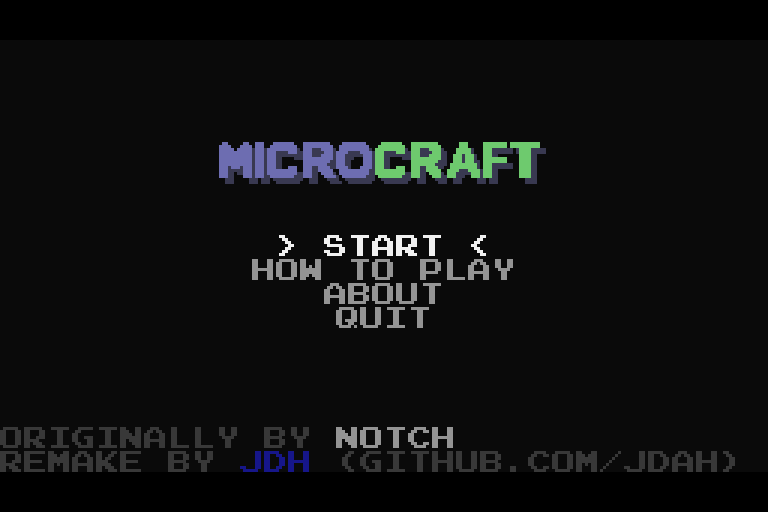
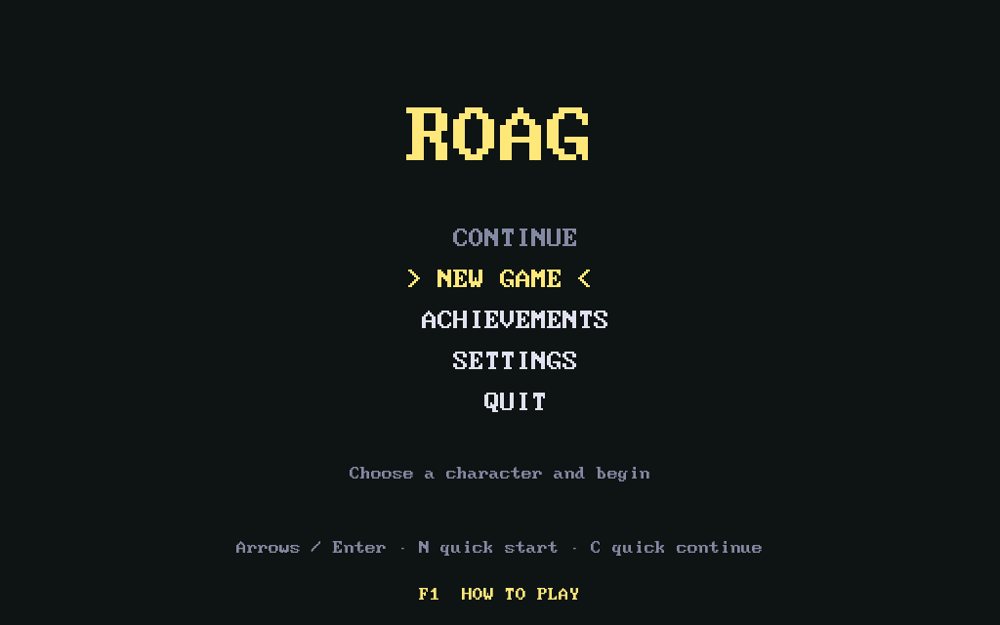
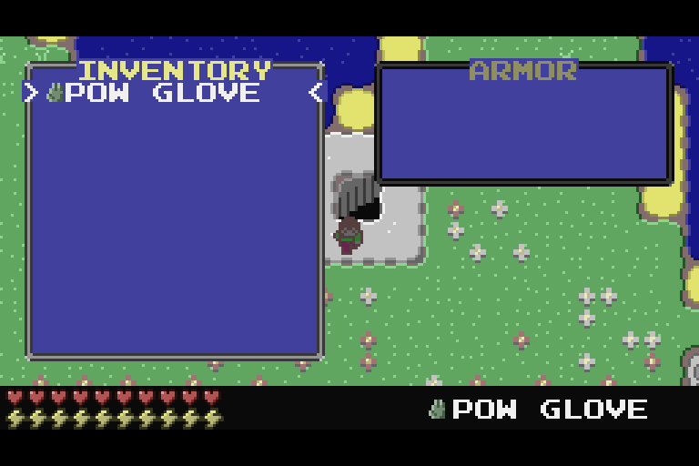
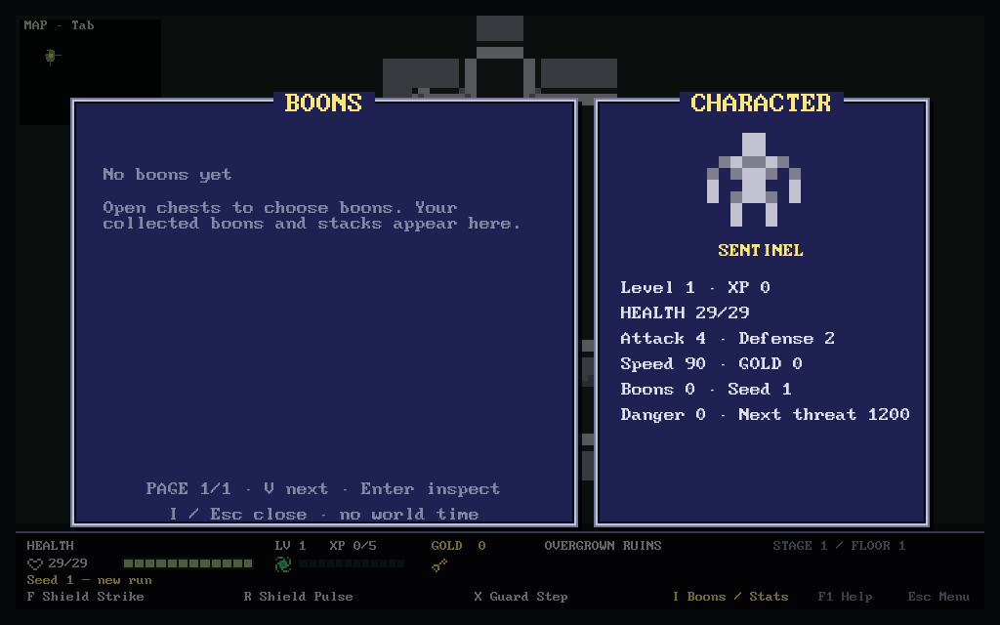
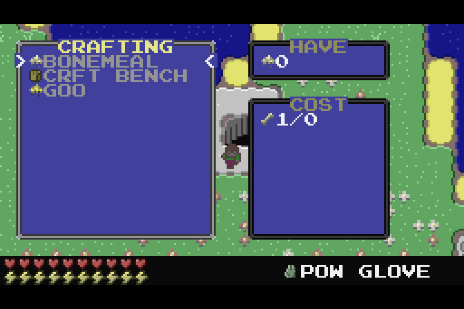
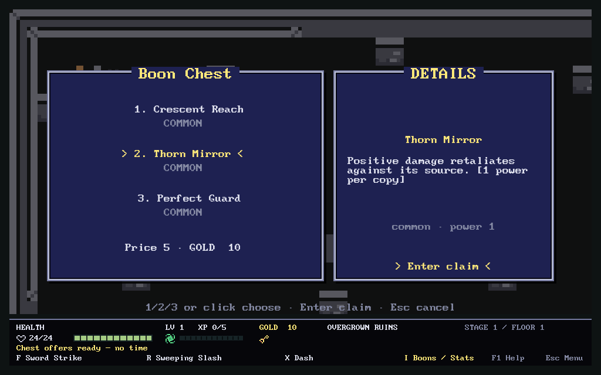
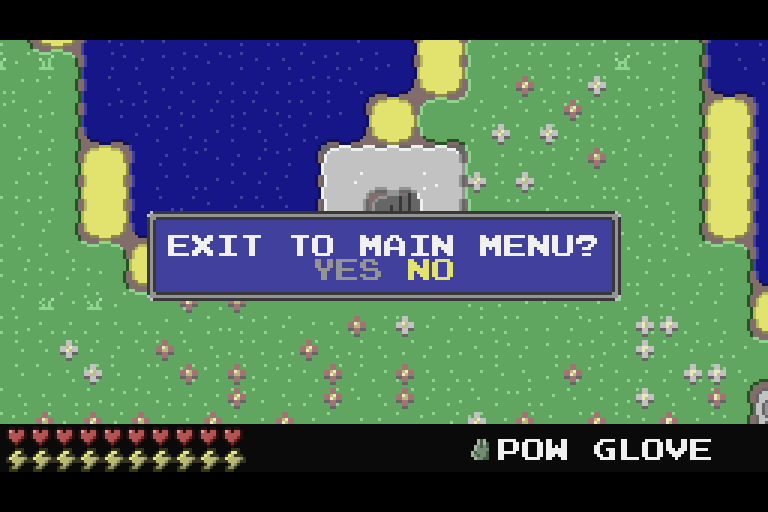
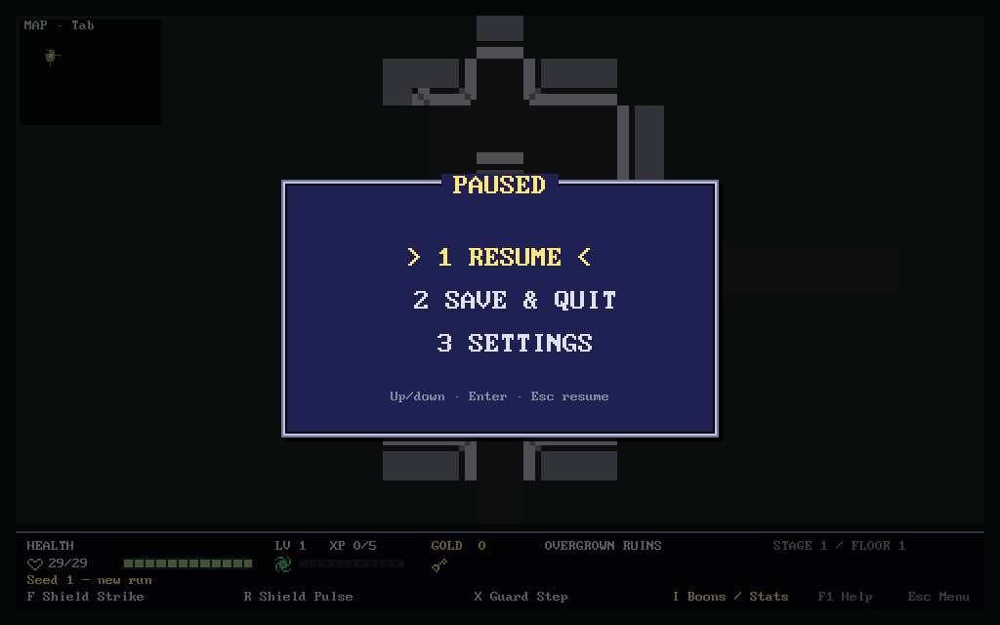

# Focused pixel menus and compact HUD

ROAG now uses short menu lists, pixel-framed dialogs and a compact bottom HUD,
inspired by [jdah's Microcraft](https://github.com/jdah/microcraft). The permanent
right sidebar is gone. The map viewport is 992×520 instead of 704×608 at the
same 1024×640 window and unchanged tile zoom. Combat, fog range, world geometry,
RNG, scheduler, saves, profile and art binding IDs are unchanged.

## What was actually inspected

Microcraft was cloned under `/var/tmp/roag-microcraft-k7Awda/reference`, compiled
with the installed OpenJDK 27, and run under Xvfb. An AWT Robot navigated its
real menus and captured the window. These are application captures, not mockups:

- [Title](visuals/microcraft-reference/title.png)
- [Help](visuals/microcraft-reference/how-to-play.png)
- [Appearance](visuals/microcraft-reference/appearance.png)
- [Difficulty](visuals/microcraft-reference/difficulty.png)
- [Welcome](visuals/microcraft-reference/welcome.png)
- [Gameplay / small HUD](visuals/microcraft-reference/game-hud.png)
- [Inventory](visuals/microcraft-reference/inventory.png)
- [Crafting / have / cost panels](visuals/microcraft-reference/crafting.png)
- [Pause confirmation](visuals/microcraft-reference/pause.png)
- [About](visuals/microcraft-reference/about.png)

The unmodified build hit a Java `AudioSystem.getClip()` exception because no
matching audio output line was exposed. The temporary compiled test build
substituted a no-op Sound class; menu, rendering and game sources were not
modified. The muted reference then navigated all ten captured contexts. It
also printed a nonfatal ScreencastHelper warning and a procedural-stair count
warning. This establishes menu/render inspection, not reference audio support.

The relevant reference files were `gui/mainmenu/MainMenu.java`, `gui/Menu.java`,
`gui/DialogMenu.java`, `gui/ColorSelectMenu.java`, `gui/DifficultySelectMenu.java`,
`gui/ItemListMenu.java`, `gui/PlayerInventoryMenu.java`,
`gui/crafting/CraftingMenu.java`, `gui/PauseMenu.java` and `gui/HUD.java`.
The temporary Java capture driver and audio adapter remain in the temporary
inspection directory. No Java runtime, submodule, copied game engine or
Microcraft asset dependency was added to ROAG. Reference screenshots retain
[Microcraft's MIT license](visuals/microcraft-reference/LICENSE.txt).

## Adaptation

| Reference pattern | ROAG implementation |
| --- | --- |
| Plain title list with `> selection <` | Continue, New Game, Achievements, Settings, Quit; no card grid |
| A focused appearance step | Six-class list with only the chosen character's portrait, description and stats |
| Blue framed dialogs with title in border | Shared frames for help, settings, pause, chests, routes, boons and terminal screens |
| Inventory plus supporting panel | `I` opens the boon list beside character stats; Enter inspects a boon |
| Crafting list with focused requirements/details | Chest list shows three names/rarities and one selected effect description, price and claim action |
| Small gameplay HUD | Health, XP/level, gold, location, committed-attack feedback, one result line and action keys at the bottom |

Difficulty modes, crafting, appearance-color editing and other Microcraft game
mechanics were not added. The implementation is original LÖVE code using ROAG's
existing state, callbacks and asset resolver. Published HUD panels/icons/glyphs,
title/pause backdrops and event effects retain their existing runtime hooks.
Ordinary movement, locked impacts, event order and 80ms actor slides are intact.

## Controls

- **Title:** arrows and Enter, or click an option. Continue opens the one saved
  run's summary. New Game opens character selection. Existing `N`, `C`, `1–6`
  shortcuts remain. Terminal/incompatible/corrupt saves show why Continue is
  unavailable, and replacing a save still requires confirmation.
- **Character:** arrows / `1–6`, or click a row; Enter or Begin New Game starts.
- **Settings:** arrows / mouse wheel choose a pack; Enter or click applies.
  `Esc` / Back returns. The active pack has `*`; the focused row has arrows.
- **Pause:** `Esc`, then arrows and Enter or click. `1` resumes, `2` / `S`
  saves and quits, `3` opens settings. The existing save verification remains.
- **Boons / stats:** `I` or the bottom HUD label. `V` / left/right / wheel
  pages; up/down selects; Enter or double-click inspects. `I` / Esc closes.
  Stack counts and the highest owned rarity's effect appear in the detail.
- **Help:** `F1` or its visible label. F1 / Enter / Esc / click returns to the
  previous view. Movement/attack input is consumed while help/stats is open.
- **Chests and routes:** `1/2/3`, arrows or click select; Enter or the explicit
  confirm action commits; Esc cancels. Browsing and canceling cost no time.
- **Gameplay:** WASD/arrows, F/R/X, Space, Tab and camera zoom are unchanged.
  `B` retains its existing developer-loadout function; boons use `I`.

Menu selection changes on keyboard or click. OS pointer movement alone does
not change it, avoiding synthetic-cursor races with keyboard navigation.
Menus do not write gameplay state. Committed-attack warnings remain prominent;
secret discoveries, level/stat gains and claimed boons use one feedback line
rather than a permanent list or a large automatic reward-art popup.

## Actual ROAG captures

| Microcraft reference | ROAG |
| --- | --- |
|  |  |
|  |  |
|  |  |
|  |  |

Additional captures: [HUD](visuals/menus-hud.png),
[character selection](visuals/menus-character.png),
[settings](visuals/menus-settings.png), [help](visuals/menus-help.png),
[replacement confirmation](visuals/menus-confirmation.png),
[defeat](visuals/menus-defeat.png).

## Verification and reproduction

```sh
TMPDIR=/var/tmp luajit tests/run.lua
TMPDIR=/var/tmp xvfb-run -a sh tests/menu_gui_smoke.sh
TMPDIR=/var/tmp xvfb-run -a sh tests/repeat_gui_smokes.sh 1
```

- Actual baseline: **329/329**. Final: **332/332**, executed in ranges `1-150`
  (150), `151-260` (110), `261-1000` (72). Three new headless tests check the
  exact shared menu hitboxes, rejected gaps/edges and pack-list bounds.
- Three passing three-process menu rounds under `/var/tmp/roag-menus-verified-1`,
  `...-2`, `...-3` (19 frames each). The extended final harness adds a replace-
  confirmation/cancel check: 20 captures in three processes, including exact
  Save/Continue, keyboard and pointer selection, all visible page assertions,
  100 help/stats open-close cycles with no texture-memory increase, unchanged
  simulation snapshots and F5. Latest artifacts: `/var/tmp/roag-menus-final-captures`.
- All **9/9** established GUI harnesses passed in
  `/var/tmp/roag-menus-regressions-verified`.
- Kenney four-process render/pixel/refresh/fallback/save checks passed in
  `/var/tmp/roag-menus-kenney-verified`. Original Dungeon/Classic acceptance
  passed four processes in `/var/tmp/roag-menus-art-verified`.
- Enemy-facing/outline GUI passed six frames; motion GUI passed 11 frames;
  biome GUI passed nine frames; finale GUI passed route, telegraph, phase,
  Victory and New Run. No actor was weakened or teleported in a claimed legal
  run; these existing finale/biome GUI setups are explicitly assisted fixtures.
- Biome disk resume passed six fresh processes. Finale disk resume/terminal
  tombstone passed three. The permanent-profile GUI passed both fresh
  processes: a legal 392-action stage trace, elite unlock, profile save and
  the next run's frozen unlocked pool. The instrumented final profile run
  reached verified Save & Quit at 4.84s; a separate CLI trace took 5.67 CPU
  seconds. These are diagnostic samples, not matched performance benchmarks.
- `love --version`: **11.5**. `git diff --check` passed. `make gui` includes
  the new menu harness.

Development regressions caught actual omissions in the compact result line
(secret discovery and boon claim feedback) and an erroneous attempt to render
`core:route/gateway` as a biome on Victory. These were fixed and the original
checks passed again. Three old checks were adapted to the new layout: the
on-demand boon hint, uppercase Save & Quit, and camera-derived fog sampling.
The original achievement/terminal-save status labels were retained.

A reward label assertion originally entered LÖVE's error screen and timed out;
reward/meta/finale-resume draw assertions now print the failure and exit, with
bounded termination. The auxiliary profile smoke also had one later timeout
without a recorded callback failure, before the instrumented rerun passed.
Logs/artifacts remain under `/var/tmp/roag-menus-*` and
`/var/tmp/roag-meta-gui-x26S6J`. No engine-crash or unexplained-hang root cause
is claimed fixed. A new-test setup issue (granting a boon before the fixture's
developer-loadout reset) was corrected without weakening the menu assertion.

Environment: Fedora WSL, Xvfb, LÖVE 11.5/LuaJIT, Mesa llvmpipe software renderer.
ROAG input was callback-driven; the Java reference used synthetic AWT Robot
input. No physical keyboard, mouse, Wacom, native Windows/macOS run or native
GPU FPS claim. Human visual acceptance remains the next check.
