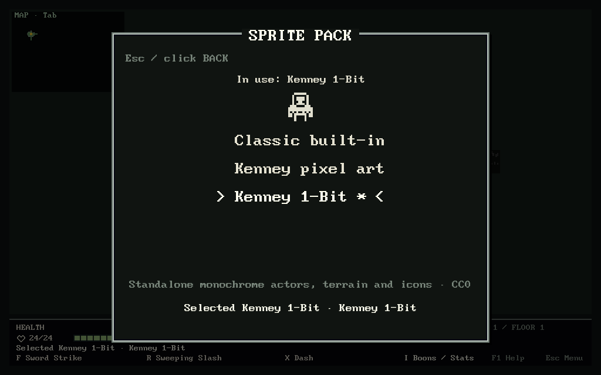
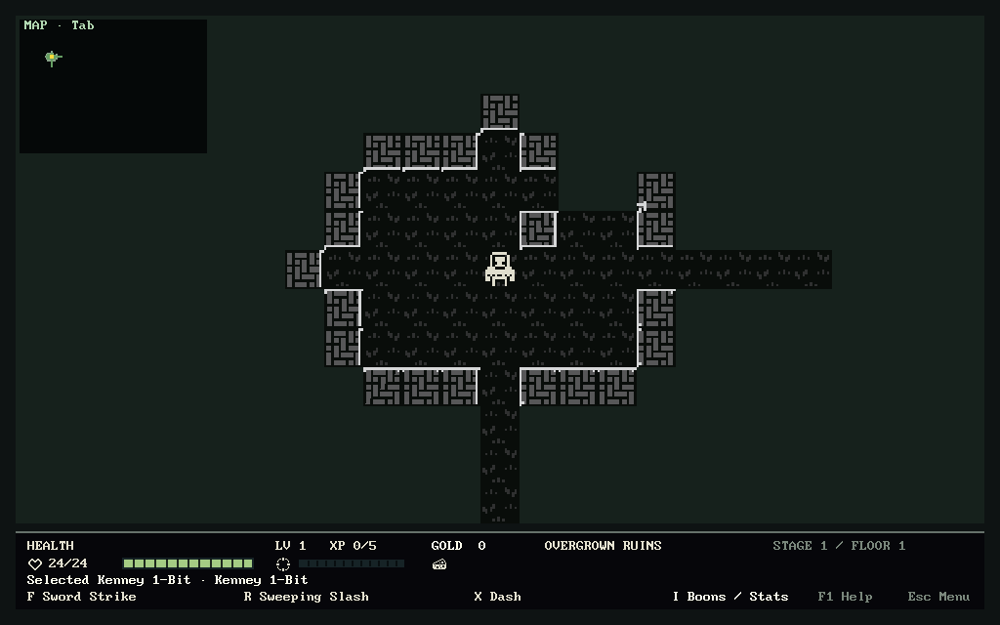
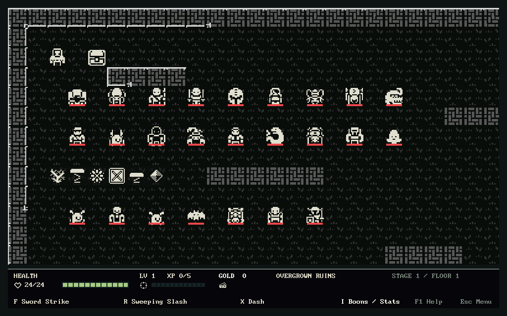
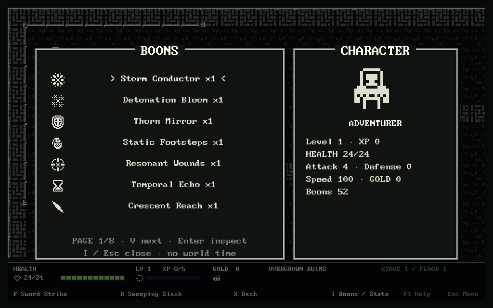
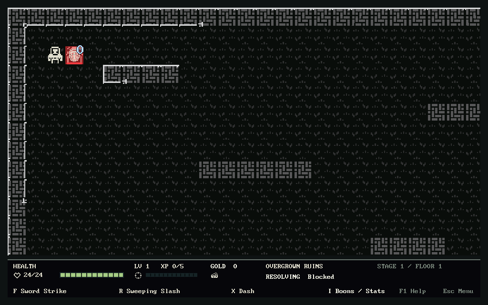

# Standalone Kenney 1-Bit pack

## Select it

Run `make game`, open **Settings**, choose **Kenney 1-Bit**, then press
**Enter** (or click its row). During a run: **Esc → 3 Settings**. The third
choice is saved independently of the active run and profile. Esc returns.
The original two choices remain: **Classic built-in** shapes, and **Kenney
pixel art**, the Micro/Caves/1-Bit mix.

```sh
make onebit       # one-launch override, does not save your choice
make kenney       # try the existing mixed Kenney pack
make game         # use saved Settings choice
```

F5 revalidates/rebuilds the selected presentation without changing the run.
Bad refreshes retain the last good renderer; bad/missing startup art uses
Classic shapes and a warning. No Paint, source project or player save is
rewritten. No Studio editor has been reintroduced into ROAG.



## What this changes

The unchanged [Kenney 1-Bit Pack](https://kenney.nl/assets/1-bit-pack) CC0
sheet already used for boon symbols is now a complete **standalone native
sprite source**. It does not require the Micro or Caves PNGs.

- All nine classes; 16 regular enemies, seven biome elites, the pursuer and
  Hollow Regent: **34 different source silhouettes**.
- Currency, food and health; both chests and open chest; closed/open doors,
  both stairs and exit; HP, XP and gold icons.
- Every current boon: **53** different icons, reused in details and offers.
- Approved keys/vaults, timed gates/plates, ore, braziers, ward flasks,
  mushrooms/overgrowth, mine rails and assembled pillars. See
  [the approved implementation record](sprite-audit/review-feedback.md).
- All six mechanical terrain markers: bramble, bog, ice, barricade, mist,
  crystal. These retain real existing gameplay properties.
- Generic hit, boon activation, Burning and blocked-hit art. Burning and
  blocked-hit had registered images but were previously drawn with shapes;
  those native sprite hooks now work in both Kenney choices.
- Seven biomes receive opaque, connected walls/water and a subtle ground
  texture. Wall/water regions cover all **47 canonical neighbor masks** each.
  Unknown neighbors are treated as connected, so joins do not reveal fogged
  passages. These are in-memory compositions from native material/frame
  pixels, not 47 newly drawn source tiles. Geometry remains unchanged.
- Menus use a monochrome palette. The current 1-Bit draw shader also converts
  health bars, tactical outlines, fog and text to grayscale; those remain
  code-drawn graphics.

Native indices and every binding are in [the audit catalogue](sprite-audit/index.html)
and [JSON inventory](sprite-audit/inventory.json). `src/onebit_visuals.lua`
stores mappings; `src/kenney_symbols.lua` stores shared boon/terrain semantics.
Texture/Quad resources are cached and replaced as a candidate on F5. There
are two backing textures: untouched symbols plus disposable surface page.



### Honest limits

Silhouettes are representative knights, wizards, beasts and plants from an
existing pack; they are not bespoke illustrations of each ROAG archetype.
Attack/hurt poses reuse the body, with existing facing/feedback. There is no
sprite animation. All seven biomes share the same monochrome base materials;
layout, enemies and terrain markers distinguish them. The mixed Kenney choice
still has biome-specific ground materials.

Nearest filtering is used. At the fixed 40px game tile, 16px art is scaled
2.5×, so some source pixels span two screen pixels and others three; it is
not an integer pixel scale. UI boon icons/terrain markers use integer 2×.
This preserves the requested fixed camera and does not silently change zoom.




The full [coverage/excess audit](ROAG_SPRITE_AUDIT.md) lists the remaining
procedural visuals and art reuse. A sprite binding does not imply a bespoke
attack animation or sprite-skinned menu.

## Reproduce verification

```sh
TMPDIR=/var/tmp luajit tests/run.lua
TMPDIR=/var/tmp xvfb-run -a sh tests/onebit_gui_smoke.sh /var/tmp/roag-onebit-check
TMPDIR=/var/tmp xvfb-run -a sh tests/repeat_gui_smokes.sh 1 /var/tmp/roag-onebit-regressions
make sprite-audit
```

The standalone harness deliberately omits **both other PNG packs**. Five
fresh LÖVE processes verify Settings/pixel rendering, exact save/Continue,
corrupt-source fallback, every enemy plus all 52 boon icons/six terrain markers,
and real `DamageBlocked`/Emberbrand Burning presentation from submitted attacks.
The last two are assisted coverage fixtures, not claims of ordinary legal runs.
Rendered opaque native pixels are checked against source RGBA; at most two
channel byte values are allowed for tint/framebuffer quantization.
Snapshots/RNG are compared exactly before/after rendering and refresh.
Screenshot callbacks report caught assertions and exit nonzero.



LÖVE 11.5 under isolated Xvfb/Mesa software rendering is callback-driven
verification, not physical keyboard/mouse/Wacom testing or native GPU profiling.
The prior intermittent GUI crash/hang has no claimed root-cause fix here.

### Historical results for the initial pack (2026-10-17)

These results describe the initial pack, not a new test run after the later
class/room expansion. Current mapping counts are in
[the refreshed audit](ROAG_SPRITE_AUDIT.md).

- Previously verified baseline: **333/333**; final full suite: **339 passed,
  0 failed** (four standalone-pack tests, two inventory tests added).
  `/var/tmp/roag-onebit-headless.log` includes the existing legal-action
  Victory, seed generation, boon, terrain, profile and persistence checks.
- Nine standard gameplay GUI harnesses: **9/9**, results/logs in
  `/var/tmp/roag-onebit-regressions/results.tsv`.
- Final standalone suite repeated twice: **10/10 fresh processes**, in
  `/var/tmp/roag-onebit-final-2` and `/var/tmp/roag-onebit-final-3`.
  Both include exact fresh-process save/Continue, source corruption, failed
  F5 retention, all-enemy/boon/mechanic coverage and combat-effect checks.
- Existing mixed Kenney suite: **6/6 processes** at `/var/tmp/roag-onebit-mix`.
  Existing symbol and seven-biome terrain suites passed at
  `/var/tmp/roag-onebit-symbols` and `/var/tmp/roag-onebit-caves`.
- Menu suite: **3/3 processes**, plus dotted-player-preview and enemy-facing
  suites passed. Artifacts: `/var/tmp/roag-onebit-menu`,
  `/var/tmp/roag-onebit-previews`, `/var/tmp/roag-onebit-facing`.
- Audit regeneration produces byte-identical HTML, JSON and CSV. Its decoded
  RGBA output was compared byte-for-byte with LÖVE ImageData for all three
  full source sheets (`/var/tmp/roag-audit-decoder-crge2ffq`). Source
  checksums remain unchanged. `love --version`: **11.5**;
  `git diff --check` passed. No failures/hangs in these completed runs.

The five selected screenshots above are checked into `docs/visuals/`; all
raw process artifacts/logs are local under `/var/tmp`, not player saves.
